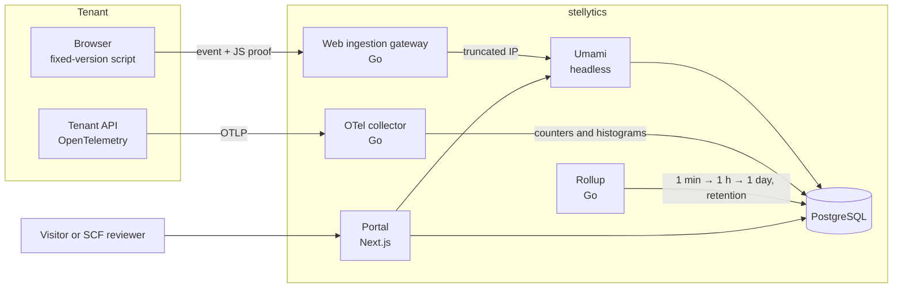

# stellytics

Open-source **web and API analytics** for projects in the [Stellar](https://stellar.org) ecosystem, built for the *Web and API Analytics for Stellar Ecosystem Projects* RFP of the [Stellar Community Fund](https://communityfund.stellar.org) (SCF).

Each project measures the usage of its website and API. SCF operators get one comparable view across projects. Nothing is collected that identifies a visitor.

> **Status: public demo.** The ingestion pipelines, the dashboards and the production infrastructure are implemented and tested in CI, and a proof of concept is live at [stellytics.xyz](https://stellytics.xyz). The demo shows **sample data, not real usage**, until a real project is configured for it. This version of the portal is public and read-only: it has no sign-up and no login. There are no pilots yet; what is left is in [`docs/progress.md`](docs/progress.md).

## See it live

| Page | What it shows |
|---|---|
| [`/demo`](https://stellytics.xyz/demo) | The dashboards a project sees: web traffic and API metrics |
| [`/operator`](https://stellytics.xyz/operator) | The SCF operator view: projects side by side |
| [`/p/stellytics`](https://stellytics.xyz/p/stellytics) | The public card of the demo project: 30-day totals only |
| [`/docs`](https://stellytics.xyz/docs) | The guides in this repository, rendered with their diagrams |

Web events are received at `e.stellytics.xyz` and API metrics at `otlp.stellytics.xyz`.

## The problem

The SCF has no reliable, shared source of usage data for the projects it funds. Reviewers rely on numbers the projects report themselves when deciding who gets into continuation programs.

stellytics is a free, shared platform where the numbers come from measurement instead: the same script and the same pipeline for every project, so the results can be compared.

## What it measures

**Web**, collected in the browser with no cookies and no personal data:

- page views and unique visitors;
- referrers;
- session duration and bounce rate;
- country, device and browser;
- optional custom events (`window.stellytics.event`), with no wallet address, hash or amount;
- an opt-in adapter for the Stellar Wallets Kit (`window.stellytics.wallets`), which reports only the selected wallet and disconnections, never the address ([ADR 0010](docs/adr/0010-wallets-kit-opt-in-adapter.md)).

**API**, from the OpenTelemetry data a project already sends to its own APM (dual-export):

- request volume per normalized endpoint;
- status code distribution;
- p50 and p95 latency.

The collector drops traces, spans and logs. It keeps only counters and histograms.

## Privacy

The goal is GDPR compliance **without a consent banner**.

| Topic | What stellytics does |
|---|---|
| IP address | The last IPv4 octet is discarded (for IPv6 only the /48 is kept) before geolocation. The full IP is never stored, not even in logs |
| Browser | No cookies, no `localStorage`, no persistent identifier |
| Umami | Session recording and heatmaps are off |
| API | Traces, spans and logs are dropped at the collector; only counters and histograms per normalized route are kept |
| Retention | Web events: about six months (183 days). API metrics: 35 days at full detail, 25 months as aggregates |
| Residency | Data stays in the region of the VPS and the backup bucket the operator chooses. The proof of concept runs in Brazil; production moves to an EU region in Tranche 1 |

Retention details, erasure and the known gaps are in [`docs/privacy.md`](docs/privacy.md). Section 8 of that document has the provisional list of jurisdictions where opt-in may be required (EU/EEA, Germany, France, United Kingdom), pending legal advice.

## How it works



There are two flows, and they never mix:

- **Web:** the pinned script sends an event with a JS proof to the gateway. The gateway filters bots, truncates the IP and relays the event to Umami, which stores it in PostgreSQL.
- **API:** the project's service exports OTLP to its own APM and, in parallel, to the stellytics collector. The ingest key identifies the project, routes are normalized, and only metrics reach PostgreSQL.

| Component | Stack | Role |
|---|---|---|
| Portal | Next.js | Public demo dashboards, the public project card, the documentation at `/docs` and a read-only API for the SCF (`/api/v1`, with a read key) |
| Tracking script | TypeScript | Fixed, immutable versions (`/s/vX.Y.Z/n.js`), with SRI and a name that ad blockers do not block |
| Web ingestion gateway | Go | Anti-bot (rate limiting, JS execution proof, per-IP fingerprint limit), IP truncation and a cap on relays to Umami to contain saturation ([ADR 0011](docs/adr/0011-umami-relay-limit.md)) |
| [Umami](https://umami.is) v3.4.1 | Next.js | Web analytics engine, used without a fork and never exposed |
| API collector | OpenTelemetry Collector + Go components | Key-based authentication, route normalization and metric storage |
| Rollup | Go | Rolls up 1-minute API metrics into 1 hour and 1 day and applies retention (API metrics and Umami web events) |
| Database | PostgreSQL 17 | Separate databases: `umami` (web analytics) and `stellytics` (projects, keys and API metrics) |
| Infra | Docker Compose, Caddy, shell install scripts | One VPS, continuous encrypted backups to S3-compatible storage, rebuildable from this repository ([ADR 0016](docs/adr/0016-production-on-a-vps.md)) |
| Monitoring | Prometheus, blackbox exporter, Alertmanager | Separate host: availability of the portal, web ingestion and API ingestion measured from the outside, with email alerts ([ADR 0005](docs/adr/0005-external-monitoring.md)) |

In production every service runs in Docker Compose. Caddy is the only one with public ports: it terminates TLS and forwards the portal, web ingestion and API ingestion (OTLP over HTTP and gRPC) over the Docker network.

The full picture, with both flows step by step, is in [`docs/architecture.md`](docs/architecture.md). Decisions and discarded alternatives are in the [ADRs](docs/adr/README.md).

## What this version does not include

- **Sign-up and login.** The portal has no accounts screen; every page is public and read-only.
- **Per-project private dashboards.** The demo shows one project: sample data by default, or the single project named in `DEMO_TENANT_SLUG`. No other project has a public page.
- **Pilots.** No real SCF project is instrumented yet.

Progress and open items are tracked in [`docs/progress.md`](docs/progress.md).

## Documentation

| To | Read |
|---|---|
| Integrate a project (script, dual-export) | [`docs/tenant-onboarding.md`](docs/tenant-onboarding.md) and [`examples/`](examples/README.md) |
| Understand the architecture | [`docs/architecture.md`](docs/architecture.md) and the [ADRs](docs/adr/README.md) |
| Deploy and operate an instance | [`docs/deploy.md`](docs/deploy.md) and the [runbooks](docs/runbooks/README.md) |
| Check privacy and collected data | [`docs/privacy.md`](docs/privacy.md) |
| Check anti-bot and supply chain measures | [`docs/anti-bot-and-supply-chain.md`](docs/anti-bot-and-supply-chain.md) |
| Check availability and current limits | [`docs/sla.md`](docs/sla.md) and the [load report](docs/reports/load-1m-per-day.md) |
| Hand the platform over to another operator | [`docs/handover.md`](docs/handover.md) |
| Validate the deploy and onboarding guides with someone who did not write them | [`docs/validation/deploy.md`](docs/validation/deploy.md) and [`docs/validation/tenant-onboarding.md`](docs/validation/tenant-onboarding.md) |

## Running locally

Requires Node.js 24, pnpm 10 (`corepack enable`), Go 1.26 and Docker with Compose v2 and BuildKit.

```bash
pnpm install
pnpm bootstrap    # or ./scripts/bootstrap.sh
```

The bootstrap command prepares the `.env`, starts the database and Umami, generates the portal's service account in Umami and starts the whole stack.

<details>
<summary>Manual step-by-step</summary>

```bash
cp .env.example .env
docker compose up -d --wait   # database, Umami, portal, gateway, collector and rollup

# Publishes Umami on 127.0.0.1:3001 (development only) and generates the key.
docker compose -f compose.yaml -f infra/compose/umami-port.yaml up -d --wait
UMAMI_ADMIN_PASSWORD=umami UMAMI_URL=http://127.0.0.1:3001 \
  pnpm --filter @stellytics/portal umami:service-account
```

Put the printed key in `UMAMI_API_KEY`, in the root `.env`, and recreate the portal with `docker compose up -d portal`.

</details>

| Service | Address |
|---|---|
| Portal | http://localhost:3000 |
| Web ingestion gateway | http://localhost:3002 |
| API collector (OTLP) | http://localhost:4318 (HTTP) and `localhost:4317` (gRPC) |
| Mailpit (portal emails) | http://localhost:8025 |
| PostgreSQL 17 | `localhost:5432` (`stellytics`/`stellytics` and `umami`/`umami`) |

- Ports and passwords come from `.env`; copy `.env.example` to start.
- Umami publishes no port by default. The `infra/compose/umami-port.yaml` override (used above) opens its UI at http://127.0.0.1:3001. Details in [`docs/umami.md`](docs/umami.md).
- `docker compose down -v` deletes the data, and the next start begins from scratch.
- Tests: `pnpm lint`, `pnpm typecheck` and `pnpm test` at the root; for Go, `go test -race ./...` from inside `services/`.

## Production deployment

Production is one Debian/Ubuntu VPS with Docker Compose. It runs the portal, the web gateway, the OTLP API, Umami, Postgres with continuous encrypted backup (WAL-G to S3-compatible storage) and Caddy.

| Step | What to do | Tool |
|---|---|---|
| 1. Prerequisites | Debian/Ubuntu VPS, DNS, an S3 bucket and SMTP | `sudo ./init.sh` |
| 2. Configuration | Fill in domains, SMTP and the backup bucket; secrets are generated by `init.sh` | `.env.production` |
| 3. Deploy | Build and start the services and the daily backup timer | `sudo ./deploy.sh` |
| 4. Analytics | Change Umami's initial password and set up its API key | `infra/scripts/admin-tunnel.sh` tunnel |
| 5. Monitoring | External probes and email alerts on a second host | `infra/monitoring/configure.sh` |

To update, pull the new code and run `sudo ./deploy.sh` again; data is preserved. The step-by-step is in [`docs/deploy.md`](docs/deploy.md), and the operating procedures are in the [runbooks](docs/runbooks/README.md).

## Repository layout

```
apps/
  portal/            Next.js portal: public demo, docs and the SCF read API
packages/
  tracker/           Tracking script (TypeScript, esbuild)
services/            Single Go module (go.mod)
  ingest-web/        Web ingestion gateway
  collector/         OpenTelemetry collector (OCB manifest)
    components/      Key authentication, route normalization, Postgres exporter
  rollup/            API metric rollups and retention
  loadtest/          Load testing tool (web and API)
  internal/          Shared code for the Go tests (database with the portal migrations)
infra/               Docker Compose, Caddy, monitoring and operations scripts
examples/            Reference integrations (HTML, SPA, SSR, backend with OTel)
scripts/             Dependency license and vulnerability checks
docs/                ADRs, specs, guides, runbooks and progress log
```

The portal, the script, each Go service, `infra/` and `examples/` have their own `README.md`.

- **TypeScript:** pnpm workspaces (`apps/*`, `packages/*`, `examples/*`) and Turborepo. pnpm only installs versions published at least 14 days ago (`minimumReleaseAge` in `pnpm-workspace.yaml`).
- **Go:** a single module, in `services/`.

## CI and supply chain

Every PR runs [`ci.yml`](.github/workflows/ci.yml): lint, type checks and tests for TypeScript and Go, the end-to-end tests on the local Compose stack, the full production stack with a local S3 (Caddy routes, backup and restore) and the monitoring stack. The check to require is the `ci` aggregator.

- **Dependencies locked** by lockfile, and only releases at least 14 days old (pnpm and [Renovate](renovate.json)).
- **Licenses and vulnerabilities** checked by [`dependencies.yml`](.github/workflows/dependencies.yml). Only OSI-approved licenses are accepted, with temporary, dated exceptions (`scripts/licenses/allowed.json`) and third-party attribution in [`docs/third-party-notices.md`](docs/third-party-notices.md). To avoid distributing sharp/libvips (LGPL-3.0), the portal's image optimizer is disabled and `/_next/image` returns 404.
- **Ad blockers:** [`adblock.yml`](.github/workflows/adblock.yml) checks daily that the most widely used block lists let the script and the ingestion routes through.
- These two workflows stay out of the `ci` aggregator, because their results change without any code change.
- **Release:** each image goes to `ghcr.io/romulospl/stellytics/<name>`, signed with cosign and with an attested SBOM.

To verify a published image:

```bash
cosign verify ghcr.io/romulospl/stellytics/<name>:<version> \
  --certificate-identity-regexp '^https://github.com/romulospl/stellytics/\.github/workflows/release\.yml@refs/tags/v' \
  --certificate-oidc-issuer https://token.actions.githubusercontent.com
```

Details are in [`docs/anti-bot-and-supply-chain.md`](docs/anti-bot-and-supply-chain.md).

## Contributing

The full guide is in [`CONTRIBUTING.md`](CONTRIBUTING.md), and vulnerabilities are reported as described in [`SECURITY.md`](SECURITY.md). Questions and bugs go to the [issues](https://github.com/romulospl/stellytics/issues/new/choose), which are the public support channel.

- Commits follow [Conventional Commits 1.0.0-beta.4](https://www.conventionalcommits.org/en/v1.0.0-beta.4/), for example `feat(collector): add Stellar address normalization`.
- New architecture decisions become an ADR in [`docs/adr/`](docs/adr/README.md), based on the [template](docs/adr/template.md).

## License

[MIT](LICENSE).
