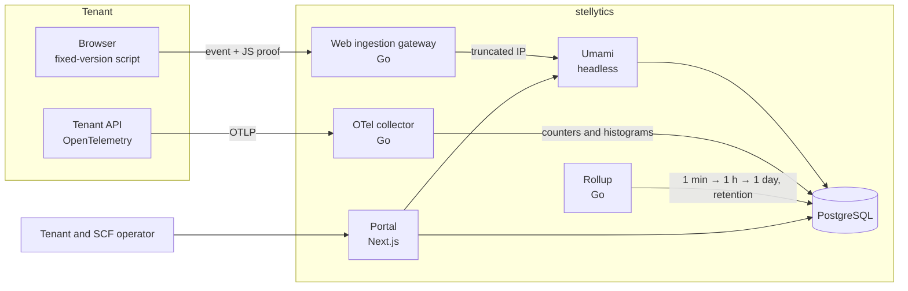

# stellytics

Open source, multi-tenant **web and API analytics** platform for projects in the [Stellar](https://stellar.org) ecosystem, proposed for the *Web and API Analytics for Stellar Ecosystem Projects* RFP of the [Stellar Community Fund](https://communityfund.stellar.org) (SCF).

> **Status:** the MVP code is implemented and tested in CI: portal, tracking script, web gateway, API collector, metric rollups, tenant and SCF dashboards, and production infrastructure as code. **No real production deployment has been applied yet** and there are no pilots; what is left is listed in [`docs/andamento.md`](docs/andamento.md).

## The problem

The SCF has no reliable, unified source of usage data for the projects it funds. Today reviewers rely on numbers reported by the projects themselves to decide who gets into continuation programs.

stellytics offers a shared, free platform where:

- each project (tenant) measures the usage of its website and API and sees only its own data;
- SCF operators see and compare the metrics of every project.

## What the platform measures

**Web**, collected on the frontend only, with no cookies and no personal data:

- page views and unique visitors;
- referrers;
- session duration and bounce rate;
- country, device and browser;
- optional custom events (`window.stellytics.event`), with no wallet address, hash or amount;
- an opt-in adapter for the Stellar Wallets Kit (`window.stellytics.wallets`), which reports only the selected wallet and disconnections, never the address ([ADR 0010](docs/adr/0010-adaptador-opt-in-do-wallets-kit.md)).

**API**, from the OpenTelemetry data the project already sends to its own APM (dual-export):

- request volume per normalized endpoint;
- status code distribution;
- p50 and p95 latency.

The collector drops traces, spans and logs and keeps only counters and histograms.

## Architecture



| Component | Stack | Role |
|---|---|---|
| Portal | Next.js | Self-service sign-up (with optional prior approval), tenant dashboards, global SCF dashboards and a read-only API for the SCF (`/api/v1`) |
| Tracking script | TypeScript | Fixed, immutable versions (`/s/vX.Y.Z/n.js`), with SRI and a name that ad blockers don't block |
| Web ingestion gateway | Go | Anti-bot (rate limiting, JS execution proof, per-IP fingerprint limit), IP truncation and a cap on relays to Umami to contain saturation ([ADR 0011](docs/adr/0011-limite-de-repasses-ao-umami.md)) |
| [Umami](https://umami.is) v3.4.1 | Next.js | Web analytics engine, used without a fork |
| API collector | OpenTelemetry Collector + Go components | Key-based authentication, route normalization and metric storage |
| Rollup | Go | Rolls up 1-minute API metrics into 1 hour and 1 day and applies retention (API metrics and Umami web events) |
| Database | PostgreSQL 17 | Separate databases: `umami` (web analytics) and `stellytics` (tenants, keys and API metrics, with 24 months of aggregates) |
| Infra | Docker Compose, Caddy, shell install scripts | One VPS, continuous encrypted backups to S3-compatible storage, rebuildable from this repository ([ADR 0016](docs/adr/0016-producao-em-vps.md)) |
| Monitoring | Prometheus, blackbox exporter, Alertmanager | Separate host: availability of the portal, web ingestion and API ingestion measured from the outside, with email alerts ([ADR 0005](docs/adr/0005-monitoramento-externo.md)) |

In production, every service runs in Docker Compose. Caddy is the only service with public ports: it terminates TLS automatically and forwards the portal, web ingestion and API ingestion (OTLP over HTTP and gRPC) over the Docker network. Umami is never exposed.

The full picture, with both flows, is in [`docs/arquitetura.md`](docs/arquitetura.md). Decisions and discarded alternatives are in the ADRs ([index](docs/adr/README.md)); the foundational ones are:

- [0001 — Umami as the base tool](docs/adr/0001-ferramenta-base.md)
- [0002 — Architecture and stack](docs/adr/0002-arquitetura-e-stack.md)
- [0003 — Tenant isolation is the portal's responsibility](docs/adr/0003-isolamento-no-portal.md)
- [0014 — Production infrastructure on Docker Compose](docs/adr/0014-infra-em-docker-compose.md)
- [0016 — Production on a single VPS, without high availability](docs/adr/0016-producao-em-vps.md)

## Documentation

| To | Read |
|---|---|
| Integrate a project (script, dual-export, dashboards) | [`docs/onboarding-de-tenant.md`](docs/onboarding-de-tenant.md) and [`examples/`](examples/README.md) |
| Deploy and operate an instance | [`docs/deploy.md`](docs/deploy.md) and the [runbooks](docs/runbooks/README.md) |
| Privacy and collected data | [`docs/privacidade.md`](docs/privacidade.md) |
| Anti-bot and supply chain | [`docs/anti-bot-e-cadeia-de-suprimentos.md`](docs/anti-bot-e-cadeia-de-suprimentos.md) |
| Availability and current limits | [`docs/sla.md`](docs/sla.md) and the [load report](docs/relatorios/carga-1m-dia.md) |
| Progress and open items | [`docs/andamento.md`](docs/andamento.md) |

## Repository layout

```
apps/
  portal/            Next.js portal: sign-up, tenant and SCF dashboards
packages/
  tracker/           Tracking script (TypeScript, esbuild)
services/            Single Go module (go.mod)
  ingest-web/        Web ingestion gateway
  collector/         OpenTelemetry collector (OCB manifest)
    components/      Key authentication, route normalization, Postgres exporter
  rollup/            API metric rollups and retention
  loadtest/          Load testing tool (web and API)
  internal/          Shared code for the Go tests (database with the portal migrations)
infra/               Docker Compose, Caddy, monitoring and operations scripts
examples/            Reference integrations (HTML, SPA, SSR, backend with OTel)
scripts/             Dependency license and vulnerability checks
docs/                ADRs, specs, guides, runbooks and progress log
```

The portal, the script, each Go service, `infra/` and `examples/` have their own `README.md`.

- **TypeScript:** pnpm workspaces (`apps/*`, `packages/*`, `examples/*`) and Turborepo. pnpm only installs versions published at least 14 days ago (`minimumReleaseAge` in `pnpm-workspace.yaml`).
- **Go:** a single module, in `services/`.

## Running locally

Requires Node.js 24, pnpm 10 (`corepack enable`), Go 1.26 and Docker with Compose v2 and BuildKit.

```bash
pnpm install
pnpm bootstrap    # or ./scripts/bootstrap.sh
```

The bootstrap command prepares the `.env`, starts the database and Umami, generates the portal's service account automatically and starts the whole stack.

<details>
<summary>Manual step-by-step</summary>

```bash
cp .env.example .env
docker compose up -d --wait   # database, Umami, portal, gateway, collector and rollup

# Publishes Umami on 127.0.0.1:3001 (development only) and generates the key.
docker compose -f compose.yaml -f infra/compose/umami-port.yaml up -d --wait
UMAMI_ADMIN_PASSWORD=umami UMAMI_URL=http://127.0.0.1:3001 \
  pnpm --filter @stellytics/portal umami:service-account
```

Put the printed key in `UMAMI_API_KEY`, in the root `.env`, and recreate the portal with `docker compose up -d portal`.

</details>

| Service | Address |
|---|---|
| Portal | http://localhost:3000 |
| Web ingestion gateway | http://localhost:3002 |
| API collector (OTLP) | http://localhost:4318 (HTTP) and `localhost:4317` (gRPC) |
| Mailpit (portal emails) | http://localhost:8025 |
| PostgreSQL 17 | `localhost:5432` (`stellytics`/`stellytics` and `umami`/`umami`) |

- Ports and passwords: copy `.env.example` to `.env`.
- Umami publishes no port by default; the `infra/compose/umami-port.yaml` override (used above) opens its UI at http://127.0.0.1:3001. Details in [`docs/umami.md`](docs/umami.md).
- Local test accounts (two project owners and one operator) come from the development seed (`SEED_DEV_DATA`); accounts and password are in [`apps/portal/README.md`](apps/portal/README.md).
- `docker compose down -v` deletes the data, and the next start begins from scratch.
- Tests: `pnpm lint`, `pnpm typecheck` and `pnpm test` at the root; for Go, `go test -race ./...` from inside `services/`.

## Production deployment

Production is one Debian/Ubuntu VPS with Docker Compose: `sudo ./init.sh`, fill in `.env.production`, then `sudo ./deploy.sh`. It starts the portal, web gateway, OTLP API, Umami, Postgres with continuous encrypted backup (WAL-G to S3-compatible storage) and Caddy.

| Step | What to do | Tool |
|---|---|---|
| 1. Prerequisites | Debian/Ubuntu VPS, DNS, an S3 bucket and SMTP | `sudo ./init.sh` |
| 2. Configuration | Fill in domains, SMTP and the backup bucket; secrets are generated by `init.sh` | `.env.production` |
| 3. Deploy | Build and start the services and the daily backup timer | `sudo ./deploy.sh` |
| 4. Analytics | Change Umami's initial password and set up its API key | `infra/scripts/admin-tunnel.sh` tunnel |
| 5. Monitoring | External probes and email alerts on a second host | `infra/monitoring/configure.sh` |

To update, pull the new code and run `sudo ./deploy.sh` again; data is preserved. The step-by-step is in [`docs/deploy.md`](docs/deploy.md); operating procedures are in the [runbooks](docs/runbooks/README.md).

## CI and supply chain

Every PR runs [`ci.yml`](.github/workflows/ci.yml): lint, type checks and tests for TypeScript and Go, the end-to-end tests on the local Compose stack, the full production stack with a local S3 (Caddy routes, backup and restore) and the monitoring stack. The check to require is the `ci` aggregator.

- **Dependencies locked** by lockfile, and only releases at least 14 days old (pnpm and [Renovate](renovate.json)).
- **Licenses and vulnerabilities** checked by [`dependencies.yml`](.github/workflows/dependencies.yml); only OSI-approved licenses, with temporary, dated exceptions (`scripts/licenses/allowed.json`) and third-party attribution in [`docs/avisos-de-terceiros.md`](docs/avisos-de-terceiros.md). To avoid distributing sharp/libvips (LGPL-3.0), the portal's image optimizer is disabled and `/_next/image` returns 404.
- **Ad blockers:** [`adblock.yml`](.github/workflows/adblock.yml) checks daily that the most widely used block lists let the script and the ingestion routes through.
- These two workflows stay out of the `ci` aggregator, because their results change without any code change.
- **Release:** each image goes to `ghcr.io/romulospl/stellytics/<name>`, signed with cosign and with an attested SBOM.

To verify a published image:

```bash
cosign verify ghcr.io/romulospl/stellytics/<name>:<version> \
  --certificate-identity-regexp '^https://github.com/romulospl/stellytics/\.github/workflows/release\.yml@refs/tags/v' \
  --certificate-oidc-issuer https://token.actions.githubusercontent.com
```

Details are in [`docs/anti-bot-e-cadeia-de-suprimentos.md`](docs/anti-bot-e-cadeia-de-suprimentos.md).

## Privacy

The goal is GDPR compliance **without a consent banner**:

- **IP:** the last IPv4 octet is discarded (for IPv6 only the /48 is kept) before geolocation. The full IP is never stored, not even in logs.
- **Browser:** no cookies, `localStorage` or persistent identifiers.
- **Umami:** session recording and heatmaps are disabled.
- **API:** traces, spans and logs are dropped at the collector; only counters and histograms per normalized route are kept.
- **Retention:** web events in Umami are kept for about six months (183 days, enforced by the rollup job); API metrics, 35 days at full detail and 25 months as aggregates.
- **Erasure (right to erasure):** anyone with a portal account can delete their own account in `/settings`, with email confirmation — this deletes the user's project, its Umami sites and API metrics, and anonymizes the person's actions in the audit log. The SCF operator can delete the data of a removed project. The same job enforces automatic retention of web events.
- **Residency:** data stays in the region of the VPS and backup bucket chosen by the operator, which must be declared; not decided yet ([`docs/privacidade.md`](docs/privacidade.md)).
- **Jurisdictions:** the provisional list of jurisdictions where opt-in may be required (EU/EEA, Germany, France, United Kingdom) is in [`docs/privacidade.md`](docs/privacidade.md), section 8, pending legal advice.

The details, including retention, erasure flows and known gaps, are in [`docs/privacidade.md`](docs/privacidade.md).

## Roadmap

The E1 to E6 code is implemented; the E7 guides are written and waiting to be tested by an outside person; E8 (pilots) has not started and E9 is partial. The backlog lives in the [issues](https://github.com/romulospl/stellytics/issues), organized into epics, and on the [project board](https://github.com/users/romulospl/projects/1).

| Epic | Scope |
|---|---|
| [E1](https://github.com/romulospl/stellytics/issues/1) | Monorepo foundation and infrastructure |
| [E2](https://github.com/romulospl/stellytics/issues/2) | Multi-tenancy, sign-up and access control |
| [E3](https://github.com/romulospl/stellytics/issues/3) | Web analytics collection |
| [E4](https://github.com/romulospl/stellytics/issues/4) | Web analytics dashboards |
| [E5](https://github.com/romulospl/stellytics/issues/5) | API analytics pipeline (OpenTelemetry) |
| [E6](https://github.com/romulospl/stellytics/issues/6) | API analytics dashboards |
| [E7](https://github.com/romulospl/stellytics/issues/7) | Documentation, privacy and compliance |
| [E8](https://github.com/romulospl/stellytics/issues/8) | Pilots with real SCF projects |
| [E9](https://github.com/romulospl/stellytics/issues/9) | Post-MVP: SLA, scale, API keys and handover |
| [E10](https://github.com/romulospl/stellytics/issues/63) | Proposal and submission to the SCF |

## Contributing

The full guide is in [`CONTRIBUTING.md`](CONTRIBUTING.md), and vulnerabilities are reported as described in [`SECURITY.md`](SECURITY.md). Questions and bugs go to the [issues](https://github.com/romulospl/stellytics/issues/new/choose), which are the public support channel.

- Commits follow [Conventional Commits 1.0.0-beta.4](https://www.conventionalcommits.org/en/v1.0.0-beta.4/), for example `feat(collector): add Stellar address normalization`.
- New architecture decisions become an ADR in [`docs/adr/`](docs/adr/README.md), based on the [template](docs/adr/template.md).

## License

[MIT](LICENSE).
