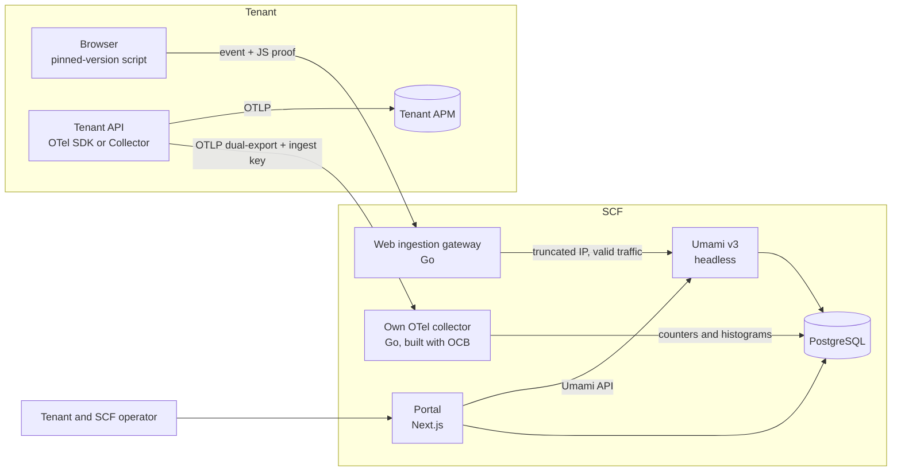

# 0002. Product architecture and stack

- **Status:** Accepted. The IaC tool was superseded by [ADR 0004](0004-hosting-and-backup.md): OpenTofu in place of Terraform (license).
- **Date:** 13/11/2026
- **Depends on:** [ADR 0001](0001-base-tool.md)

## Context

The product has two fronts, web analytics and API analytics, which share tenants, access control, database and dashboards. RFP constraints:

- a single open source monorepo, with IaC, that another community team can take over;
- frontend-only web analytics, with a pinned-version script, names that are not blocked by ad blockers, anti-bot and GDPR without opt-in;
- an OpenTelemetry collector that drops traces, spans and logs and stores counters and histograms in PostgreSQL;
- route normalization by fixed rules in code;
- about 1,000,000 API requests per day (an average of 12 req/s) and 24-month retention of the aggregations;
- zero cost for tenants and for the SCF.

## Decision

Two languages, each where it pays off most:

- **TypeScript** for everything that has an interface and for the browser script, in the same ecosystem as Umami.
- **Go** for ingestion (OTel collector and web gateway), because the OpenTelemetry Collector already solves the heavy part of OTLP.

### Components

| Component | Folder | Stack | Responsibility |
|---|---|---|---|
| Portal | `apps/portal` | Next.js (App Router), React, Drizzle ORM, Better Auth, Tailwind, ECharts | Self-service sign-up, login, the tenant's web dashboard (through the Umami API), API dashboards, global SCF dashboards, project removal |
| Tracking script | `packages/tracker` | TypeScript, esbuild | Pinned-version script (`/s/vX.Y.Z/<name>.js`), immutable, with an SRI hash, proof of JS execution and a payload compatible with Umami's `/api/send` |
| Web ingestion gateway | `services/ingest-web` | Go (`net/http`) | Endpoints with neutral names, validation of the JS proof, in-memory limit of fingerprints per IP, IP truncation and relay to Umami |
| API collector | `services/collector` | Own distribution of the OpenTelemetry Collector (OCB) | OTLP gRPC/HTTP receiver, `memory_limiter`, `batch`, `spanmetrics` connector |
| Collector's own components | `services/collector/components` | Go | Authentication extension by ingest key (sets `tenant.id`), route normalization processor and exporter to PostgreSQL |
| Umami | pinned official image | — | Ingestion, storage and API of the web statistics |
| Database | — | PostgreSQL | One cluster with separate databases: `umami` (managed by Umami) and `stellytics` (tenants, keys and API metrics) |
| Infra | `infra/` | Terraform, Ansible, Docker Compose, Caddy | Provisioning, deploy, TLS and reverse proxy |
| Observability | `infra/monitoring` | Prometheus, Grafana, Alertmanager | Health of ingestion and of the dashboards, alerts |
| Examples | `examples/` | Static HTML, SPA, Next.js SSR, backend with OTel | Reference integration and end-to-end tests |

### Monorepo

- pnpm workspaces and Turborepo for the TypeScript packages.
- One Go module in `services/` (gateway, collector components and OCB manifest).
- MIT license.

### API data in PostgreSQL

- A metrics table by tenant, service, normalized route, status code and time bucket, with a counter and a latency histogram in fixed buckets (which allow p50/p95 to be computed).
- **Native partitioning by month**: old data leaves with `DROP PARTITION`, without an expensive `DELETE`.
- Rollups from 1 minute to 1 hour and 1 day done by an idempotent job. Aggregations retained for at least 24 months.
- **No TimescaleDB:** continuous aggregates and compression are under the TSL license, which is not OSI-approved.

### Privacy by architecture

- The gateway zeroes the last octet of the IPv4 (and truncates the IPv6 to /48) and delivers the truncated IP to Umami through the `CLIENT_IP_HEADER` header. Geolocation uses the truncated IP and no component persists the full IP.
- No cookies and no storage in the browser. Umami session recording and heatmaps off.
- Geolocation with GeoLite2 (MaxMind) or DB-IP Lite.

### Quality and supply chain

- Tests: Vitest and Playwright (TypeScript); `go test` with testcontainers-go against a real Postgres.
- CI on GitHub Actions, with actions pinned by SHA and mandatory lockfiles.
- Renovate for dependencies; no release adopted when less than two weeks old.
- SBOM (syft) and signed images (cosign).

### Infrastructure

- Terraform creates the VM, firewall and DNS; Ansible deploys the images with Docker Compose; Caddy takes care of TLS and the reverse proxy.
- Hosting in the European Union, to state data residency clearly.
- Continuous Postgres backup (WAL-G or pgBackRest) to object storage.

## Alternatives considered

| Alternative | Why not |
|---|---|
| Everything in TypeScript (collector and gateway in Fastify) | A single language, but it would require reimplementing OTLP gRPC/HTTP, `spanmetrics`, batching and backpressure. It remains an alternative if the team is TypeScript-only |
| Official OTel collector (contrib) with no code of our own | It has no exporter to PostgreSQL, no authentication that sets the tenant from the key and none of the RFP's normalization rules |
| Fork of Umami with API dashboards and sign-up | Makes security updates harder (see ADR 0001) |
| TimescaleDB or ClickHouse for metrics | Timescale has features under a non-OSI license; ClickHouse adds another database, and the RFP requires PostgreSQL |
| Kubernetes | Heavy for the MVP load and for the handover to a community team. It can be reassessed in the high availability plan (issue [#52](https://github.com/romulospl/stellytics/issues/52)) |

## Consequences

- The team needs to know TypeScript and Go. Go stays restricted to `services/`.
- The portal needs a service account in Umami to create users, teams and sites and to read the statistics.
- The backlog gains two pieces that do not have their own issue yet: the **portal** and the **web ingestion gateway**.
- The MVP load fits in one VM. High availability and the SLA targets are left for post-MVP (issue [#52](https://github.com/romulospl/stellytics/issues/52)).
