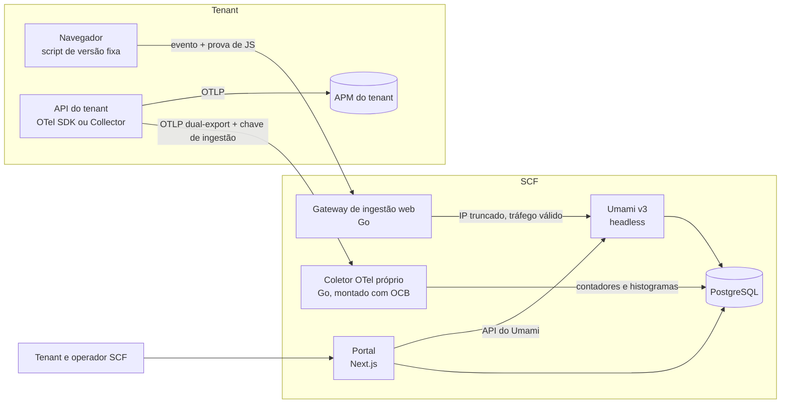

# 0002. Arquitetura e stack do produto

- **Status:** Aceito. A ferramenta de IaC foi substituída pelo [ADR 0004](0004-hospedagem-e-backup.md): OpenTofu no lugar do Terraform (licença).
- **Data:** 13/11/2026
- **Depende de:** [ADR 0001](0001-ferramenta-base.md)

## Contexto

O produto tem duas frentes, analytics web e analytics de API, que compartilham tenants, controle de acesso, banco e painéis. Restrições do RFP:

- um único monorepo open source, com IaC, que outra equipe da comunidade consiga assumir;
- analytics web só do frontend, com script de versão fixa, nomes que não sejam bloqueados por ad blockers, anti-bot e GDPR sem opt-in;
- coletor OpenTelemetry que descarta traces, spans e logs e grava contadores e histogramas no PostgreSQL;
- normalização de rotas por regras fixas no código;
- cerca de 1.000.000 de requisições de API por dia (média de 12 req/s) e retenção de 24 meses das agregações;
- custo zero para tenants e para o SCF.

## Decisão

Duas linguagens, cada uma onde rende mais:

- **TypeScript** para tudo que tem interface e para o script do navegador, no mesmo ecossistema do Umami.
- **Go** para a ingestão (coletor OTel e gateway web), porque o OpenTelemetry Collector já resolve a parte pesada de OTLP.

### Componentes

| Componente | Pasta | Stack | Responsabilidade |
|---|---|---|---|
| Portal | `apps/portal` | Next.js (App Router), React, Drizzle ORM, Better Auth, Tailwind, ECharts | Cadastro self-service, login, painel web do tenant (via API do Umami), painéis de API, painéis globais do SCF, remoção de projetos |
| Script de rastreamento | `packages/tracker` | TypeScript, esbuild | Script de versão fixa (`/s/vX.Y.Z/<nome>.js`), imutável, com hash SRI, prova de execução de JS e payload compatível com o `/api/send` do Umami |
| Gateway de ingestão web | `services/ingest-web` | Go (`net/http`) | Endpoints com nomes neutros, validação da prova de JS, limite de fingerprints por IP em memória, truncamento do IP e repasse ao Umami |
| Coletor de API | `services/collector` | Distribuição própria do OpenTelemetry Collector (OCB) | Receiver OTLP gRPC/HTTP, `memory_limiter`, `batch`, `spanmetrics` connector |
| Componentes próprios do coletor | `services/collector/components` | Go | Extensão de autenticação por chave de ingestão (define o `tenant.id`), processor de normalização de rotas e exporter para PostgreSQL |
| Umami | imagem oficial fixada | — | Ingestão, armazenamento e API das estatísticas web |
| Banco | — | PostgreSQL | Um cluster com bancos separados: `umami` (gerenciado pelo Umami) e `notify` (tenants, chaves e métricas de API) |
| Infra | `infra/` | Terraform, Ansible, Docker Compose, Caddy | Provisionamento, deploy, TLS e proxy reverso |
| Observabilidade | `infra/monitoring` | Prometheus, Grafana, Alertmanager | Saúde da ingestão e dos painéis, alertas |
| Exemplos | `examples/` | HTML estático, SPA, Next.js SSR, backend com OTel | Integração de referência e testes de ponta a ponta |

### Monorepo

- pnpm workspaces e Turborepo para os pacotes TypeScript.
- Um módulo Go em `services/` (gateway, componentes do coletor e manifesto do OCB).
- Licença MIT.

### Dados de API no PostgreSQL

- Tabela de métricas por tenant, serviço, rota normalizada, status code e balde de tempo, com contador e histograma de latência em buckets fixos (que permitem calcular p50/p95).
- **Particionamento nativo por mês**: dado antigo sai com `DROP PARTITION`, sem `DELETE` caro.
- Rollups de 1 minuto para 1 hora e 1 dia feitos por job idempotente. Agregações retidas por pelo menos 24 meses.
- **Sem TimescaleDB:** os continuous aggregates e a compressão estão sob a licença TSL, que não é aprovada pela OSI.

### Privacidade por arquitetura

- O gateway zera o último octeto do IPv4 (e trunca o IPv6 para /48) e entrega o IP truncado ao Umami pelo header de `CLIENT_IP_HEADER`. A geolocalização usa o IP truncado e nenhum componente persiste o IP completo.
- Nenhum cookie nem storage no navegador. Gravação de sessão e heatmaps do Umami desligados.
- Geolocalização com GeoLite2 (MaxMind) ou DB-IP Lite.

### Qualidade e cadeia de suprimentos

- Testes: Vitest e Playwright (TypeScript); `go test` com testcontainers-go contra Postgres real.
- CI no GitHub Actions, com actions fixadas por SHA e lockfiles obrigatórios.
- Renovate para dependências; nenhuma release adotada com menos de duas semanas.
- SBOM (syft) e imagens assinadas (cosign).

### Infraestrutura

- Terraform cria VM, firewall e DNS; Ansible faz o deploy das imagens com Docker Compose; Caddy cuida de TLS e proxy reverso.
- Hospedagem na União Europeia, para declarar data residency com clareza.
- Backup contínuo do Postgres (WAL-G ou pgBackRest) para object storage.

## Alternativas consideradas

| Alternativa | Por que não |
|---|---|
| Tudo em TypeScript (coletor e gateway em Fastify) | Uma linguagem só, mas exigiria reimplementar OTLP gRPC/HTTP, `spanmetrics`, batching e backpressure. Fica como alternativa se a equipe for só de TypeScript |
| Coletor OTel oficial (contrib) sem código próprio | Não tem exporter para PostgreSQL, autenticação que defina o tenant pela chave nem as regras de normalização do RFP |
| Fork do Umami com painéis de API e cadastro | Dificulta atualizações de segurança (ver ADR 0001) |
| TimescaleDB ou ClickHouse para métricas | Timescale tem recursos sob licença não OSI; ClickHouse adiciona outro banco, e o RFP exige PostgreSQL |
| Kubernetes | Pesado para a carga do MVP e para a transferência a uma equipe da comunidade. Pode ser reavaliado no plano de alta disponibilidade (issue [#52](https://github.com/romulospl/notify/issues/52)) |

## Consequências

- A equipe precisa saber TypeScript e Go. O Go fica restrito a `services/`.
- O portal precisa de uma conta de serviço no Umami para criar usuários, equipes e sites e para ler as estatísticas.
- O backlog ganha duas peças que ainda não têm issue própria: o **portal** e o **gateway de ingestão web**.
- A carga do MVP cabe em uma VM. Alta disponibilidade e as metas de SLA ficam para o pós-MVP (issue [#52](https://github.com/romulospl/notify/issues/52)).
