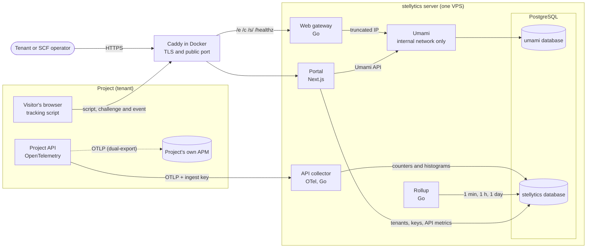
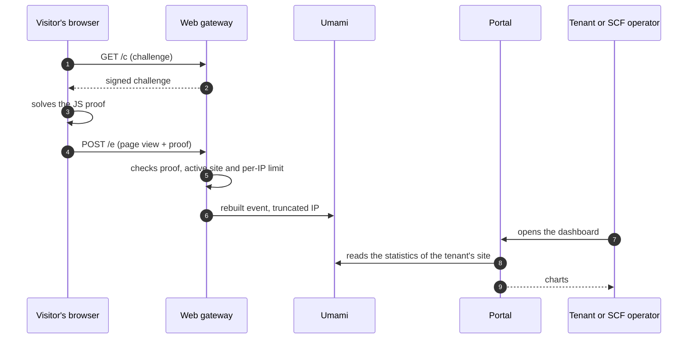
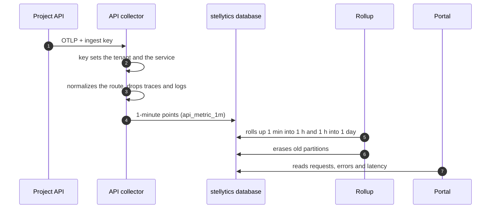

# Architecture and stack

High-level view of stellytics ([#39](https://github.com/romulospl/stellytics/issues/39)): what each piece does, how the data moves and where everything runs. The text comes first, in plain language; the technical details are in [`decisions.md`](decisions.md) and in the links of each section.

## In one sentence

stellytics measures the usage of the sites and APIs of Stellar ecosystem projects. Each project (a *tenant*) sees only its own numbers; the SCF operators see all projects and can compare them.

## Overview

> **Abbreviations in this diagram:** a *tenant* is a client project with data isolated from the others; *OTLP* is the open format for sending measurements (OpenTelemetry, or OTel); *dual-export* is sending the same measurement to two destinations; *APM* is the monitoring tool the client project already uses; *TLS* is the HTTPS padlock.

Dotted line: what the project already sends today to its own APM, without going through stellytics. In production, OTLP also enters through Caddy, on its own host on 443 ([ADR 0014](decisions.md#0014-infra-in-docker-compose)); the drawing shows the collector without repeating the proxy.

## Web flow: from a visit to a chart

In plain words:

1. The project pastes one line into its site, which loads the tracking script (pinned version, with a hash to check that it has not been altered).
2. The script sends only basic data about each page viewed: address, referrer, title, language and screen size. It uses no cookies and stores nothing in the browser.
3. Before accepting the event, the gateway requires a small computation done by the browser (proof that real JavaScript is running, which stops most robots) and limits how many different "devices" a single address can simulate.
4. The gateway erases the last part of the IP (the last number in IPv4; in IPv6, everything beyond the /48 prefix) before handing the event to Umami. The full IP is never written.
5. Umami, which is not reachable from outside, stores the event. The portal queries Umami and shows the numbers only to the owner of the site.

More details: [`services/ingest-web/README.md`](../services/ingest-web/README.md), [`packages/tracker`](../packages/tracker/), [`umami.md`](umami.md) and [ADR 0001](decisions.md#0001-base-tool).

## API flow: from a request to a metric

In plain words:

1. The project already measures its own API with OpenTelemetry (an open standard). It starts sending the same measurement to stellytics as well (*dual-export*), with an ingest key created in the portal.
2. The key decides who the data belongs to. Any project identification that comes inside the measurement is ignored.
3. The collector groups the requests by service, route (with numbers and addresses replaced by placeholders, such as `/accounts/{address}`), method, status and minute, and also stores the distribution of response times, which makes it possible to compute p50 and p95.
4. Traces, spans and logs are dropped: none of that is written.
5. A separate job (the rollup) summarizes the minute data into hour and day and erases the old details: 35 days at the minute and 25 months for the hours and days.

More details: [`docs/specs/e5-api-pipeline.md`](specs/e5-api-pipeline.md), [`services/collector/README.md`](../services/collector/README.md) and [`examples/api-backend`](../examples/api-backend/).

## The pieces of the stack

| Piece | What it is for | Technology | Where it is |
|---|---|---|---|
| Portal | Sign-up, login, tenant and SCF dashboards, ingest keys | Next.js, Better Auth, Drizzle, Tailwind | [`apps/portal`](../apps/portal/) |
| Tracking script | Measures visits on the projects' sites | TypeScript, esbuild | [`packages/tracker`](../packages/tracker/) |
| Web gateway | Entry point for web events: JS proof, limits, IP truncation | Go | [`services/ingest-web`](../services/ingest-web/) |
| Umami | Stores and computes the web statistics, with no public interface | Umami 3.4.1, official image with no patch | [`docs/umami.md`](umami.md) |
| API collector | Receives OTLP, authenticates by the key, normalizes routes, writes metrics | OpenTelemetry Collector built with OCB, components in Go | [`services/collector`](../services/collector/) |
| Rollup | Rolls up the metrics and applies retention | Go, SQL functions | [`services/rollup`](../services/rollup/) |
| Database | One PostgreSQL with two databases: `umami` (Umami's) and `stellytics` (tenants, keys, API metrics) | PostgreSQL 17 | [`infra/compose`](../infra/compose/) |
| Caddy | The only public service, automatic TLS | Docker Compose container | [`infra/caddy/Caddyfile`](../infra/caddy/Caddyfile) |
| Infrastructure | Prepares the VPS and publishes the system | `init.sh`, `deploy.sh`, Docker Compose | [`infra/`](../infra/README.md) |
| Monitoring | Sends an email if the portal or ingestion goes down | Prometheus, blackbox, Alertmanager | [`infra/monitoring`](../infra/monitoring/) |

Why two languages: TypeScript for everything that has a screen and for the browser script; Go for ingestion, where the OpenTelemetry ecosystem already solves the heavy part ([ADR 0002](decisions.md#0002-architecture-and-stack)). Umami is used as it comes, without a fork, so that its security updates can be applied ([ADR 0001](decisions.md#0001-base-tool)).

## How projects are kept isolated

- The project each person belongs to always comes from the login session, never from a value sent by the browser. Asking for another project's resource results in "not found".
- All access to the database and to Umami goes through functions that require that context, and the code linter forbids going around it ([ADR 0003](decisions.md#0003-portal-isolation)).
- In the API data, the owner of the metric is the owner of the ingest key.
- An automated test suite covers isolation on web and API ([`apps/portal/test/isolation.test.ts`](../apps/portal/test/isolation.test.ts) and [`services/collector/e2e`](../services/collector/e2e/)).

## Privacy by design

- The full IP is never written; the approximate location uses the truncated IP.
- No cookies and no browser storage.
- Umami session recording and heatmaps stay off.
- No gateway or Caddy log keeps the IP or `User-Agent`. Caddy has no access log and filters request data out of the error logs; the gateway only records the path of its own routes (`/e`, `/c`), never the page visited.

## Infrastructure

- **Where it runs:** a single VPS, with no high availability, with the data in `STELLYTICS_DATA_DIR` (default `/srv/stellytics`) and continuous, encrypted backup (WAL-G) to S3-compatible storage. Provider and region are the operator's choice ([ADR 0016](decisions.md#0016-production-on-a-vps), [`deploy.md`](deploy.md)).
- **How it is created:** `init.sh` installs Docker and generates `.env.production`; `deploy.sh` builds the images and brings up the whole stack, including Caddy, with Docker Compose, and installs the daily backup timer. Caddy receives 80 and 443; administration is through an SSH tunnel.
- **Who watches it:** a second host, separate from the VPS, tests the portal and the gateway from outside every 15 seconds and sends an email if something goes down ([ADR 0005](decisions.md#0005-external-monitoring)).
- **Supply chain:** images published per release, with SBOM and signature (cosign), but the default deploy builds from the checkout and does not check the signature; new dependencies only after 14 days.

## Current state

This document describes what is on `main`. Differences from the design above:

- The **API collector and the rollup** are in `infra/compose/prod.yaml`; Caddy publishes the OTLP routes as described in [ADR 0014](decisions.md#0014-infra-in-docker-compose). The local CI stack tests the Caddy routes; no real production has been applied yet ([`progress.md`](progress.md)).
- The API ingestion monitoring tests the OTLP host with a POST without a key (`API_URL` in `infra/monitoring/configure.sh`, [ADR 0005](decisions.md#0005-external-monitoring)).
- Grafana, planned in ADR 0002, has not been adopted for now; ADR 0005 explains why.
- High availability and SLA targets are left for after the MVP (issue [#52](https://github.com/romulospl/stellytics/issues/52)).
