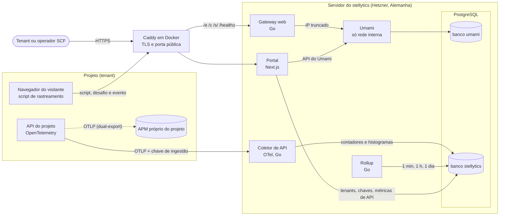
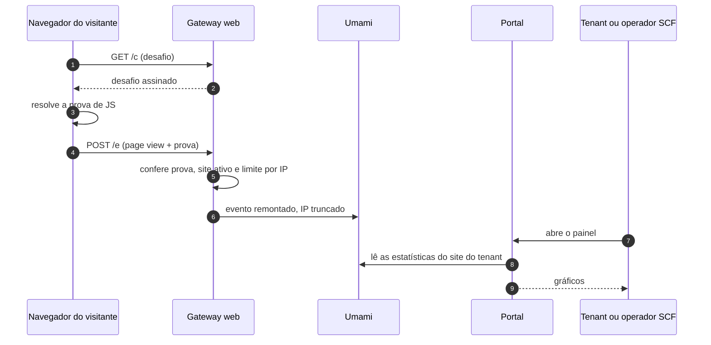
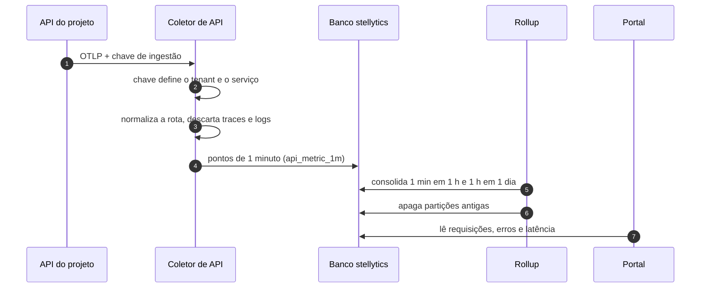

# Arquitetura e stack

Visão de alto nível do stellytics ([#39](https://github.com/romulospl/stellytics/issues/39)): o que cada peça faz, como os dados andam e onde tudo roda. O texto vem primeiro, em linguagem simples; os detalhes técnicos estão nos [ADRs](adr/README.md) e nos links de cada seção.

## Em uma frase

O stellytics mede o uso de sites e de APIs dos projetos do ecossistema Stellar. Cada projeto (um *tenant*) vê só os próprios números; as pessoas operadoras do SCF veem todos os projetos e podem compará-los.

## Visão geral

> **Siglas deste diagrama:** *tenant* é um projeto cliente com dados isolados dos demais; *OTLP* é o formato aberto de envio de medições (OpenTelemetry, ou OTel); *dual-export* é mandar a mesma medição para dois destinos; *APM* é a ferramenta de monitoramento que o projeto cliente já usa; *TLS* é o cadeado HTTPS.

Linha pontilhada: envio que o projeto já faz hoje para o próprio APM, sem passar pelo stellytics. Na produção, o OTLP também entra pelo Caddy, num host próprio na 443 ([ADR 0014](adr/0014-infra-em-docker-compose.md)); o desenho mostra o coletor sem repetir o proxy.

## Fluxo web: de uma visita a um gráfico

Em palavras simples:

1. O projeto cola uma linha no site dele, que carrega o script de rastreamento (versão fixa, com hash para conferir que não foi alterado).
2. O script manda só dados básicos de cada página vista: endereço, origem, título, idioma e tamanho de tela. Não usa cookies nem guarda nada no navegador.
3. Antes de aceitar o evento, o gateway exige uma pequena conta feita pelo navegador (prova de que há JavaScript de verdade rodando, o que barra a maior parte dos robôs) e limita quantos "aparelhos" diferentes um mesmo endereço pode simular.
4. O gateway apaga o último trecho do IP (o último número no IPv4; no IPv6, tudo além do prefixo /48) antes de entregar o evento ao Umami. O IP completo nunca é gravado.
5. O Umami, que não é acessível de fora, guarda o evento. O portal consulta o Umami e mostra os números só ao dono do site.

Mais detalhes: [`services/ingest-web/README.md`](../services/ingest-web/README.md), [`packages/tracker`](../packages/tracker/), [`umami.md`](umami.md) e o [ADR 0001](adr/0001-ferramenta-base.md).

## Fluxo de API: de uma requisição a uma métrica

Em palavras simples:

1. O projeto já mede a própria API com OpenTelemetry (um padrão aberto). Ele passa a enviar a mesma medição também ao stellytics (*dual-export*), com uma chave de ingestão criada no portal.
2. A chave decide a quem o dado pertence. Qualquer identificação de projeto que venha dentro da medição é ignorada.
3. O coletor junta as requisições por serviço, rota (com números e endereços trocados por marcadores, como `/accounts/{address}`), método, status e minuto, e guarda também a distribuição de tempos de resposta, que permite calcular p50 e p95.
4. Traces, spans e logs são descartados: nada disso é gravado.
5. Um job separado (o rollup) resume os dados de minuto em hora e dia e apaga os detalhes antigos: 35 dias no minuto e 25 meses nas horas e dias.

Mais detalhes: [`docs/specs/e5-pipeline-de-api.md`](specs/e5-pipeline-de-api.md), [`services/collector/README.md`](../services/collector/README.md) e [`examples/api-backend`](../examples/api-backend/).

## As peças da stack

| Peça | Para que serve | Tecnologia | Onde está |
|---|---|---|---|
| Portal | Cadastro, login, painéis do tenant e do SCF, chaves de ingestão | Next.js, Better Auth, Drizzle, Tailwind | [`apps/portal`](../apps/portal/) |
| Script de rastreamento | Mede visitas nos sites dos projetos | TypeScript, esbuild | [`packages/tracker`](../packages/tracker/) |
| Gateway web | Porta de entrada dos eventos web: prova de JS, limites, truncamento de IP | Go | [`services/ingest-web`](../services/ingest-web/) |
| Umami | Guarda e calcula as estatísticas web, sem interface pública | Umami 3.4.1, imagem oficial sem patch | [`docs/umami.md`](umami.md) |
| Coletor de API | Recebe OTLP, autentica pela chave, normaliza rotas, grava métricas | OpenTelemetry Collector montado com OCB, componentes em Go | [`services/collector`](../services/collector/) |
| Rollup | Consolida as métricas e aplica a retenção | Go, funções SQL | [`services/rollup`](../services/rollup/) |
| Banco | Um PostgreSQL com dois bancos: `umami` (do Umami) e `stellytics` (tenants, chaves, métricas de API) | PostgreSQL 17 | [`infra/compose`](../infra/compose/) |
| Caddy | Único serviço público, TLS automático | Contêiner Docker Compose | [`infra/caddy/Caddyfile`](../infra/caddy/Caddyfile) |
| Infraestrutura | Cria o servidor e publica o sistema | OpenTofu, Ansible, Docker Compose | [`infra/`](../infra/README.md) |
| Monitoramento | Avisa por e-mail se o portal ou a ingestão saírem do ar | Prometheus, blackbox, Alertmanager | [`infra/monitoring`](../infra/monitoring/) |

Por que duas linguagens: TypeScript para tudo que tem tela e para o script do navegador; Go para a ingestão, onde o ecossistema do OpenTelemetry já resolve a parte pesada ([ADR 0002](adr/0002-arquitetura-e-stack.md)). O Umami é usado como ele vem, sem fork, para que as atualizações de segurança dele possam ser aplicadas ([ADR 0001](adr/0001-ferramenta-base.md)).

## Como os projetos ficam isolados

- O projeto a que cada pessoa pertence vem sempre da sessão de login, nunca de um valor enviado pelo navegador. Pedir o recurso de outro projeto resulta em "não encontrado".
- Todo acesso ao banco e ao Umami passa por funções que exigem esse contexto, e o linter do código proíbe contornar isso ([ADR 0003](adr/0003-isolamento-no-portal.md)).
- Nos dados de API, o dono da métrica é o da chave de ingestão.
- Uma suíte de testes automatizados cobre o isolamento na web e na API ([`apps/portal/test/isolation.test.ts`](../apps/portal/test/isolation.test.ts) e [`services/collector/e2e`](../services/collector/e2e/)).

## Privacidade por construção

- O IP completo nunca é gravado; a localização aproximada usa o IP truncado.
- Sem cookies e sem armazenamento no navegador.
- Gravação de sessão e mapas de calor do Umami ficam desligados.
- Nenhum log do gateway ou do Caddy guarda IP ou `User-Agent`. O Caddy não tem access log e filtra dados de requisição dos logs de erro; o gateway só registra o caminho das próprias rotas (`/e`, `/c`), nunca a página visitada.

## Infraestrutura

- **Onde roda:** uma VM na Hetzner em Nuremberg (Alemanha), com os dados num volume separado e backup contínuo e cifrado no Object Storage da Hetzner, também na Alemanha ([ADR 0004](adr/0004-hospedagem-e-backup.md), [`deploy.md`](deploy.md)).
- **Como é criada:** OpenTofu cria VM, firewall e bucket; Ansible instala Docker e sobe toda a pilha, incluindo Caddy, com Docker Compose. Caddy recebe 80 e 443; a administração é por túnel SSH.
- **Quem vigia:** uma segunda VM, em outro data center (Falkenstein), testa de fora o portal e o gateway a cada 15 segundos e manda e-mail se algo cair ([ADR 0005](adr/0005-monitoramento-externo.md)).
- **Supply chain:** imagens publicadas por release, com SBOM e assinatura (cosign); dependências novas só depois de 14 dias.

## Estado atual

Este documento descreve o que está na `main`. Diferenças em relação ao desenho acima:

- O **coletor de API e o rollup** estão em `infra/compose/prod.yaml`; o Caddy publica as rotas OTLP conforme o [ADR 0014](adr/0014-infra-em-docker-compose.md). A pilha local do CI testa as rotas do Caddy; nenhuma produção real foi aplicada ainda ([`andamento.md`](andamento.md)).
- O monitoramento da ingestão de API testa o host OTLP com um POST sem chave (`monitor_api_url`, [ADR 0005](adr/0005-monitoramento-externo.md)).
- O Grafana, previsto no ADR 0002, não foi adotado por enquanto; o ADR 0005 explica por quê.
- Alta disponibilidade e metas de SLA ficam para depois do MVP (issue [#52](https://github.com/romulospl/stellytics/issues/52)).
