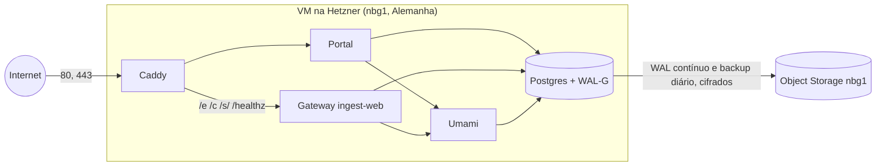

# Deploy da produção

Como recriar a produção do notify do zero, só com este repositório e os segredos ([#14](https://github.com/romulospl/notify/issues/14)). As decisões estão no [ADR 0004](adr/0004-hospedagem-e-backup.md); os arquivos, em [`infra/`](../infra/README.md).

## Visão geral



- Só o Caddy tem porta pública. O firewall da Hetzner abre 80 e 443 para todos e 22 só para as redes de administração.
- Os dados do Postgres e os certificados do Caddy ficam num volume da Hetzner montado em `/srv/notify`, que sobrevive se a VM for recriada. Sem o volume montado, o Docker e o backup não sobem (para não criar um banco vazio no disco da VM).
- Os logs do Caddy não guardam IP, cabeçalhos nem URL dos pedidos.

## Onde ficam os dados (data residency)

| O quê | Onde |
|---|---|
| VM e volume com o Postgres (bancos `notify` e `umami`) | Hetzner, Nuremberg (`nbg1`), Alemanha |
| Backups do Postgres (WAL e backups base), cifrados no cliente | Hetzner Object Storage, Nuremberg (`nbg1`), Alemanha |

O local é a variável `location` do OpenTofu. Se mudar, mude também `walg_s3_endpoint` e `walg_s3_region` no Ansible.

## O que você precisa

**Ferramentas na sua máquina:** OpenTofu 1.13.2 ou mais novo, Ansible (ansible-core 2.21), `ssh` e `openssl`. Para os comandos de administração da primeira subida, Node e pnpm (como no desenvolvimento).

**Segredos** (nunca no repositório):

| Segredo | Onde é usado | Como obter |
|---|---|---|
| `HCLOUD_TOKEN` | OpenTofu | Console da Hetzner → projeto → Security → API tokens (leitura e escrita) |
| `TF_VAR_object_storage_access_key` e `TF_VAR_object_storage_secret_key` | OpenTofu (cria o bucket) e Ansible (`walg_s3_access_key` e `walg_s3_secret_key`) | Console da Hetzner → Object Storage → Manage credentials |
| `secrets.yml` | Ansible | Copie `infra/ansible/secrets.example.yml` e preencha (senhas com `openssl rand -hex 32`) |

A chave `walg_libsodium_key` cifra os backups: **sem ela, nenhum backup pode ser restaurado**. Guarde uma cópia no cofre de senhas do time, fora da VM.

## 1. Provisionar a infraestrutura (OpenTofu)

1. Edite `infra/opentofu/production.tfvars`: tipo da VM (confira com `hcloud server-type list`), nome do bucket, sua chave SSH pública e as redes que podem entrar por SSH.
2. Rode:

   ```bash
   export HCLOUD_TOKEN=...
   export TF_VAR_object_storage_access_key=...
   export TF_VAR_object_storage_secret_key=...
   tofu -chdir=infra/opentofu init
   tofu -chdir=infra/opentofu apply -var-file=production.tfvars
   tofu -chdir=infra/opentofu output
   ```

   As saídas trazem os IPs da VM, o dispositivo do volume e o endpoint e o prefixo do backup.

## 2. DNS

Crie dois registros A (e AAAA, com o IPv6) apontando para a VM:

- o host do portal, por exemplo `app.<domínio>`;
- o host da ingestão, por exemplo `e.<domínio>`. Ele não pode ter `umami`, `analytics`, `track` nem `collect`, que os bloqueadores de anúncio barram.

O Caddy só consegue o certificado depois que os dois nomes resolvem para a VM.

## 3. Publicar as imagens

O deploy só aceita imagens publicadas pelo workflow de release, assinadas com cosign e referenciadas por digest.

1. Publique uma release no GitHub (`vX.Y.Z`). O workflow `release.yml` publica `ghcr.io/romulospl/notify/portal` e `ghcr.io/romulospl/notify/ingest-web` com a tag **sem o `v`** (`X.Y.Z`).
2. Pegue os digests:

   ```bash
   docker buildx imagetools inspect ghcr.io/romulospl/notify/portal:X.Y.Z --format '{{json .Manifest}}' | jq -r .digest
   docker buildx imagetools inspect ghcr.io/romulospl/notify/ingest-web:X.Y.Z --format '{{json .Manifest}}' | jq -r .digest
   ```

## 4. Deploy (Ansible)

1. Em `infra/ansible/`:
   - copie `inventory/production.example.yml` para `inventory/production.yml` e preencha com as saídas do OpenTofu;
   - copie `secrets.example.yml` para `secrets.yml` e preencha.
2. Em `group_vars/all.yml`, preencha:
   - os hosts (`portal_host`, `ingest_host`), `acme_email` e `mail_from`;
   - as imagens com os digests do passo 3;
   - `walg_s3_prefix`, com a saída `backup_s3_prefix`.
3. Rode, de `infra/ansible/`:

   ```bash
   ansible-playbook site.yml -e @secrets.yml
   ```

O playbook prepara a VM e sobe a aplicação:

- atualiza a VM e liga as atualizações automáticas de segurança;
- instala o Docker (com a chave do repositório conferida) e o cosign;
- monta o volume;
- copia o Compose, o Caddyfile e o `.env` (permissão 600);
- confere a assinatura das imagens;
- sobe a pilha e liga o timer do backup diário.

Ele pode rodar de novo quantas vezes for preciso; sem mudança, não altera nada.

## 5. Primeira subida

1. **Túnel de administração** (deixe aberto num terminal):

   ```bash
   infra/scripts/admin-tunnel.sh <ip-da-vm>
   ```

   Postgres em `127.0.0.1:15432`, Umami em `http://127.0.0.1:13001`. Nada disso fica exposto na internet.
2. **Troque a senha do administrador do Umami.** Ele nasce com `admin`/`umami`. Entre em `http://127.0.0.1:13001` pelo túnel e troque.
3. **Conta de serviço do Umami** (o portal usa a chave dela):

   ```bash
   cd apps/portal
   read -rs UMAMI_ADMIN_PASSWORD && export UMAMI_ADMIN_PASSWORD
   UMAMI_URL=http://127.0.0.1:13001 pnpm umami:service-account
   ```

   Ponha a chave impressa em `umami_api_key` no `secrets.yml` e rode o playbook de novo.
4. **Primeiro operador do SCF:**

   ```bash
   cd apps/portal
   read -rs OPERATOR_PASSWORD && export OPERATOR_PASSWORD
   DATABASE_URL='postgresql://notify:<notify_db_password>@127.0.0.1:15432/notify' \
     pnpm operator:create --email <e-mail> --name "<nome>"
   ```

5. **Primeiro backup base**, sem esperar o horário do timer:

   ```bash
   ssh root@<ip-da-vm> systemctl start notify-backup
   ```

## Atualizar a aplicação

Publique uma release nova, troque os digests em `group_vars/all.yml` e rode o playbook. As migrações do portal rodam na subida (`RUN_MIGRATIONS=true`).

## Backup

- **WAL contínuo:** o Postgres manda cada segmento de WAL ao Object Storage pelo `archive_command`, no máximo 60 segundos depois da escrita (`archive_timeout`).
- **Backup base diário** às 03:15 UTC, pelo timer `notify-backup.timer`. Mantém os 7 mais novos (`walg_retain_full`).
- **Ver os backups:**

  ```bash
  cd /opt/notify/infra/compose
  docker compose -f prod.yaml exec -u postgres postgres wal-g backup-list
  ```

- **Rodar um agora:** `systemctl start notify-backup`.
- A restauração é testada a cada PR pelo job `infra` do CI (`infra/compose/test/prod-stack-test.sh`): ela restaura num contêiner novo e confere que voltou também o que foi gravado depois do backup base.

## Restaurar o banco

Na VM, como root:

```bash
cd /opt/notify/infra/compose
systemctl stop notify-backup.timer
docker compose -f prod.yaml stop caddy portal ingest-web umami postgres

# Guarda os dados atuais (não apague até conferir a restauração).
mv /srv/notify/postgres /srv/notify/postgres.antes-$(date +%F-%H%M)
mkdir /srv/notify/postgres

# Traz o backup mais novo e todo o WAL depois dele.
docker compose -f prod.yaml run --rm --no-deps --entrypoint sh postgres -c \
  'chown postgres:postgres "$PGDATA" && chmod 700 "$PGDATA" && su postgres -c "notify-restore LATEST"'

docker compose -f prod.yaml up -d --wait
systemctl start notify-backup.timer
systemctl start notify-backup   # novo backup base logo depois da restauração
```

Na subida, o Postgres aplica o WAL arquivado e abre o banco numa linha do tempo nova; o WAL-G continua arquivando a partir dela.

**Voltar a um horário** (por exemplo, antes de um erro às 02:00): um backup base já contém tudo o que aconteceu até ele terminar, então o ponto de partida precisa ser um backup **concluído antes** do horário escolhido. Liste os backups e use o nome do último que terminou antes dele:

```bash
docker compose -f prod.yaml run --rm --no-deps postgres wal-g backup-list --detail

# No lugar do notify-restore LATEST do bloco acima:
docker compose -f prod.yaml run --rm --no-deps \
  -e BACKUP=<nome-do-backup> -e TARGET='2026-11-14 01:59:00+00' --entrypoint sh postgres -c \
  'chown postgres:postgres "$PGDATA" && chmod 700 "$PGDATA" && su postgres -c "notify-restore \"$BACKUP\" \"$TARGET\""'
```

O `notify-restore` descarta os alvos de recuperação que vieram dentro do backup (de uma restauração anterior), então cada restauração usa só o alvo pedido.

## Estado do OpenTofu

O estado fica em `infra/opentofu/terraform.tfstate`, na máquina de quem aplica (fora do git, porque tem dados da infraestrutura). Para compartilhar entre pessoas, guarde-o no próprio Object Storage: acrescente o bloco `backend` **dentro** do bloco `terraform` que já existe em `versions.tf`:

```hcl
terraform {
  # ... required_version e required_providers como estão ...

  backend "s3" {
    bucket                      = "<bucket-do-estado>"
    key                         = "notify/production.tfstate"
    region                      = "nbg1"
    endpoints                   = { s3 = "https://nbg1.your-objectstorage.com" }
    skip_credentials_validation = true
    skip_region_validation      = true
    skip_requesting_account_id  = true
    skip_s3_checksum            = true
    use_path_style              = true
  }
}
```

Depois rode `tofu init -migrate-state`. As credenciais vêm de `AWS_ACCESS_KEY_ID` e `AWS_SECRET_ACCESS_KEY`.

## O que ainda falta

- **Domínio e DNS na IaC:** hoje os registros são criados à mão (ADR 0004).
- **SMTP de produção:** escolher o provedor e pôr a URL em `smtp_url`.
- **Monitoramento e alertas:** [#15](https://github.com/romulospl/notify/issues/15).
- **Coletor OTLP:** entra no `prod.yaml` e no Caddyfile na issue que o cria ([#30](https://github.com/romulospl/notify/issues/30)).
