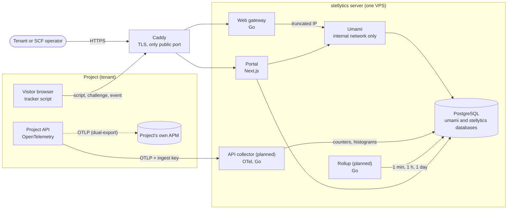

# Proposal draft: Web and API Analytics for Stellar Ecosystem Projects (stellytics)

> **DRAFT. Not submitted.** This file is a working draft for issue [#65](https://github.com/romulospl/stellytics/issues/65). Nothing here has been sent to the Stellar Community Fund (SCF). Statements about the Stellar ecosystem come from the Stellar Raven MCP (queried on 2026-11-15) and carry a source and date; anything not confirmed is marked **UNVERIFIED**. Statements about the project come from this repository (links are relative and were checked).

## 0. Open items that depend on Romulo

None of these can be decided by the drafter. Each one blocks submission or weakens it.

| # | Item | Why it matters | Status |
|---|---|---|---|
| 1 | **Referral code** (issue [#64](https://github.com/romulospl/stellytics/issues/64)) | The RFP brief says builders unknown to SCF are not eligible. The handbook says SCF "relies heavily" on referral signals, and a referral is not mandatory (see [section 11](#11-ecosystem-facts-and-sources)). | Not obtained. Decide: seek a referrer or record the decision to send without one. |
| 2 | **Budget** (section 6) | All amounts are a **PROPOSAL** built from benchmark rates, not a quote. | To validate. |
| 3 | **Team and open source history** (section 9) | The repository has no biographical data. Reviewers weigh team identity and prior work. | Placeholders only. |
| 4 | **Pilots and letters of interest** (section 8) | No letters exist yet ([#44](https://github.com/romulospl/stellytics/issues/44)). The RFP requires at least three SCF-awarded projects on web and one on API. | None secured. |
| 5 | **Language of the repository docs** | The handbook says the RFP Track proposal needs a plain-English explanation and a diagram, and reviewers "assess each application based solely on the information provided". The linked docs in this repository are in Portuguese. Acceptance criterion of #65: "README e documentos citados disponíveis em inglês". | Not done. Decide: translate before submission, or write the English summaries inline. |
| 6 | **How to present work already built** | Much of the web pipeline and the portal already exist. The handbook says Tranche 1 "should focus on actual development" and that architecture must be complete at application time. Funded scope has to be the work that remains (section 5). | Decide how to frame prior work. |
| 7 | **Legal entity, jurisdiction and payee** | Needed on the form. Not in the repository. [`docs/privacidade.md`](../privacidade.md) also leaves the operating entity open. | Not decided. |
| 8 | **Tranche structure** | The handbook says the award is "split into four payments tied to specific deliverables" and also that the "budget must be tied to three tranches". How the fourth payment fits with three tranches was **not confirmed**, so the 10/20/30/40% split (from the issue and the SCF skill references) is **UNVERIFIED for the RFP Track**. | Confirm with SCF or on the form. |
| 9 | **Private vulnerability reporting** | Enabled on 19 November 2026; [`SECURITY.md`](../../SECURITY.md) directs reporters to the private channel. | Verify access remains enabled before submission. |
| 10 | **Operating costs in the budget** | The handbook says costs should support future development, not operation (section 5). The RFP requires 12 months of hosting and support. | Decide how to present it and, ideally, ask SCF. |

## 1. Summary

stellytics is an open source, multi-tenant web and API analytics service for Stellar ecosystem projects. Each project sees only its own data. SCF operators get a global comparison view. It answers the problem stated in the RFP brief: SCF has no trusted, unified source of end-user usage data for the projects it funds, so reviewers rely on self-reported metrics.

- **Track:** RFP Track, RFP "Web and API Analytics for Stellar Ecosystem Projects" (Q4 2026, Infrastructure).
- **Base tool:** Umami v3.4.1 (MIT), used as a headless engine ([section 2](#2-why-umami-and-not-goatcounter)).
- **Web path:** version-pinned tracker with SRI, a Go gateway with a JavaScript proof of work, IP truncation, Umami, PostgreSQL.
- **API path:** OpenTelemetry dual-export to a custom collector (built with the OpenTelemetry Collector Builder) that keeps only standardized metrics in PostgreSQL and drops traces, spans and logs.
- **Hosting:** a single VPS running Docker Compose, installed with `init.sh` and `deploy.sh`; provider and region are the operator's choice and not decided yet ([ADR 0016](../adr/0016-producao-em-vps.md)).

## 2. Why Umami and not GoatCounter

The RFP requires Umami or GoatCounter and asks for the choice to be justified. The full record, with data collected from GitHub on 2026-11-13, is [ADR 0001](../adr/0001-ferramenta-base.md). Summary:

| Criterion | Umami | GoatCounter |
|---|---|---|
| License | MIT (OSI approved) | Modified EUPL 1.2 (altered compatible-license appendix); a modified license is not formally the OSI-approved one |
| Database | PostgreSQL only (since v3) | SQLite or PostgreSQL |
| Maintainers | Team of three core maintainers, many contributors | Essentially one person |
| Release cadence | Monthly releases (v3.3.1 Aug 2026 to v3.5.0 Nov 2026) | Sparse (v2.7.0 in Dec 2025) |
| Multi-site and teams | Native data model | Multi-site, fewer team features |
| Statistics API | `/stats` and `/metrics` with API keys | Simpler API |
| Client IP | Reads the header in `CLIENT_IP_HEADER`, so a truncated IP can be delivered | Own logic |

Reasons, in order of weight: OSI license without caveats; PostgreSQL is already required for the API metrics, so one database simplifies operation, backup and handover; tenants and sites already exist in Umami's model; a maintainer team lowers the risk of 12 months of operation plus a handover; Umami already computes the minimum metrics the RFP lists.

How we limit the risk of using Umami: it is pinned to v3.4.1 and normally moves by pull request after a release is at least two weeks old, subject to the documented critical/high security exception (v3.5.0 was published a day before the decision and was deliberately skipped); there is no heavy fork, reducing the work to apply upstream security fixes; the RFP 24-hour target is not a guaranteed response time; Umami is reachable only on the internal network and session replay and heatmaps are off ([`docs/umami.md`](../umami.md)). The ADR also records what Umami does not give us, and where we cover it: no open sign-up (the portal handles it), no cross-site comparison and no API metrics (both in the portal).

## 3. Stack, with a simple explanation

The diagrams and the plain-language walkthrough are in [`docs/arquitetura.md`](../arquitetura.md). The overview in short:

Note: the collector and the rollup exist and run in the development Compose, but they are **not in `infra/compose/prod.yaml` or the Caddyfile**, so they are drawn as planned for production (section 4).

In plain words:

1. A project adds one line to its site. It loads a pinned tracker that sends only the page URL, referrer, title, language and screen size. No cookies, no browser storage.
2. Before accepting an event the gateway asks the browser to solve a small computation (proof that real JavaScript runs) and limits how many distinct "devices" one IP can simulate. It then drops the last part of the IP and passes the event to Umami. The full IP is never stored.
3. A project that already measures its API with OpenTelemetry also sends the same data to stellytics. The ingest key, created in the portal, decides which tenant owns the data. The collector counts requests per service, normalized route, method, status and minute, keeps latency histograms (p50 and p95) and discards traces, spans and logs.
4. A rollup job condenses minutes into hours and days and drops old detail (35 days at 1 minute, 25 months at 1 hour and 1 day).
5. The portal shows each tenant its own web and API numbers and gives SCF operators the global view.

Why two languages: TypeScript for everything with a screen and for the browser script, Go for ingestion, where the OpenTelemetry ecosystem already solves the heavy part ([ADR 0002](../adr/0002-arquitetura-e-stack.md)). Tenant isolation is the portal's responsibility and is tested ([ADR 0003](../adr/0003-isolamento-no-portal.md), [E2 spec](../specs/e2-tenants-e-controle-de-acesso.md)).

### Coverage of the RFP technical requirements

Requirements are from the RFP brief (Scout `getRfps`, id `scf-web-api-analytics`, observed 2026-11-15). Status is from the repository on `main`.

| RFP requirement | Status today |
|---|---|
| Web metrics: page views, unique visitors, referrers, session duration, bounce rate, country, device and browser | Built: tenant dashboard and SCF dashboard ([`docs/e4-implementacao.md`](../e4-implementacao.md)); **not yet running in production** |
| GDPR-compliant web analytics (RFP wording) | **Compliance is not claimed.** [`docs/privacidade.md`](../privacidade.md) records what the system does (no cookies, no browser storage, truncated IP, residency still to be chosen and declared by the operator) and its gaps (no retention for Umami events, no account deletion, no erasure of a removed project, roles and jurisdictions to validate with counsel). Not legal advice |
| Version-pinned tracker, bot and inflation mitigation, supply-chain defenses | Built (section 7) |
| API: dual-export OTel, drop traces and spans, keep route, status and latency in PostgreSQL, 24 months of aggregates | Collector, exporter, route normalization, rollup and retention built and tested locally ([`docs/specs/e5-pipeline-de-api.md`](../specs/e5-pipeline-de-api.md)); **collector and rollup are not in `infra/compose/prod.yaml`** |
| About 1,000,000 requests a day | **Not load tested.** There is a volume estimate in the E5 spec; the load test is issue [#51](https://github.com/romulospl/stellytics/issues/51) |
| Self-service enrollment, strict isolation, global SCF view | Built, with an isolation test suite ([`docs/e2-implementacao.md`](../e2-implementacao.md)) |
| Revocable API keys for machine consumers (SCF) | **Not built** ([#48](https://github.com/romulospl/stellytics/issues/48)). Ingest keys for tenants exist, which is a different thing |
| Dashboards: private per project plus global comparison, for web and API | Built ([`docs/e4-implementacao.md`](../e4-implementacao.md), [`docs/e6-implementacao.md`](../e6-implementacao.md)) |
| One OSI-licensed monorepo with IaC, runbooks, onboarding guide, tests, security and privacy docs | MIT monorepo, production stack as code (Docker Compose, `init.sh`, `deploy.sh`), onboarding guide ([`docs/onboarding-de-tenant.md`](../onboarding-de-tenant.md)), privacy and security docs exist. **Runbooks are in PR [#111](https://github.com/romulospl/stellytics/pull/111) (open, pending merge; issue [#53](https://github.com/romulospl/stellytics/issues/53))** |
| Hosting and support for 12 months, 99.99% ingestion, 99.90% dashboards, critical and high patched in 24 hours | **Not met today** (section 5, SLA) |
| Handover to a community operator between months 6 and 12 | **Not planned in detail** ([#54](https://github.com/romulospl/stellytics/issues/54)) |
| Adoption: at least three SCF-awarded projects on web, one on API | **None** (section 8) |

## 4. Current state, stated plainly

Delivered on `main` as of 2026-11-15 (source: [`docs/andamento.md`](../andamento.md)):

- Portal with login, e-mail confirmation, self-service project onboarding, ingest keys, SCF operator role, project removal and reactivation, and the isolation suite.
- Tracker (versions pinned, SRI published) and the web gateway.
- Tenant and SCF web dashboards, tenant and SCF API dashboards.
- API collector with key authentication, route normalization, metrics exporter, rollup and retention, plus an example backend with a dual-export guide.
- Production stack for a single VPS (Docker Compose, `init.sh`, `deploy.sh`, Caddy, WAL-G backup to S3-compatible storage) and an external monitoring host, both validated in CI without real credentials ([ADR 0016](../adr/0016-producao-em-vps.md); this replaced the earlier Hetzner, OpenTofu and Ansible setup).
- Architecture, privacy, anti-bot and supply chain, deploy and onboarding documents.

**Not delivered, and this proposal does not claim otherwise:**

- **The production environment has not been applied.** No VPS, S3 storage, domain, DNS or SMTP is set up, and no release has been published. Certificate issuance and e-mail delivery were never exercised ([`docs/deploy.md`](../deploy.md), "Como este guia foi conferido").
- **The API collector and rollup are not in production** (`infra/compose/prod.yaml`, Caddyfile).
- **No pilot and no letters of interest.**
- **No load test, no high availability and no handover plan.** Runbooks are in PR [#111](https://github.com/romulospl/stellytics/pull/111), open and pending merge; they are not on `main`.
- Privacy gaps listed in [`docs/privacidade.md`](../privacidade.md): no retention configured for web events in Umami, no account deletion, no erasure of a removed project's data.
- No vulnerability scanning, no license check and no reproducible-build verification in CI ([`docs/anti-bot-e-cadeia-de-suprimentos.md`](../anti-bot-e-cadeia-de-suprimentos.md)).

## 5. Milestones, tranches and budget

### Framing

The handbook states Tranche 1 should be development, not planning, and that SCF Build tranches end in a mainnet launch with go-live metrics (Raven, SCF Handbook "Budget & Deliverable Guidelines"). The work already done is **prior work, not funded scope**. Funded scope is what separates the repository today from the RFP: production, the API path in production, real pilots, the privacy and security gaps above, load, availability, runbooks (in PR #111, pending merge), handover and 12 months of hosting.

Each milestone below is independently verifiable from outside the team: a public URL, a published release, a report committed to the repository, or a letter.

### Calendar

Handbook rules (Raven, SCF Handbook "Build Award", 2026-11-15): each tranche must be submitted within 90 days of the last payment, or the remaining funds are forfeited, and a project typically takes 3 to 6 months. Proposed calendar, counted from award approval (month 0):

| Tranche | Target | Hard limit under the handbook rule |
|---|---|---|
| T0 | Month 0 to 1 | 90 days after approval |
| T1 | Month 2 | 90 days after the T0 payment |
| T2 | Month 4 | 90 days after the T1 payment |
| T3 | Month 6 | 90 days after the T2 payment |

Four payments at the 90-day limit would run to about 12 months, so the target keeps development to about 6 months, the top of the handbook's typical range. The 12 months of operation required by the RFP start **after** the final development tranche (RFP brief) and are not part of this 6-month development calendar.

### Tranche 0: 10% (setup, tied to a deliverable)

The handbook says the award is "split into four payments tied to specific deliverables" and also that the budget "must be tied to three tranches". How the fourth payment fits was **not confirmed**. The earlier idea of a first 10% paid automatically with no deliverable (from the SCF budget reference, not the handbook) conflicts with that wording, so this draft gives T0 a concrete deliverable. **The 10/20/30/40% split is UNVERIFIED for the RFP Track.** If SCF uses three tranches, merge T0 into T1.

| # | Deliverable | Completion criteria (testable) |
|---|---|---|
| 0.1 | Production environment applied | `init.sh` and `deploy.sh` run on a real VPS in the declared region; portal and gateway answer over HTTPS on the project domain; external monitoring alerting |
| 0.2 | First signed release | Published images with SBOM and cosign signature (the deploy builds from the checkout by default and does not verify signatures) |

### Tranche 1: 20%, production web path (production itself is T0)

| # | Deliverable | Completion criteria (testable) |
|---|---|---|
| 1.1 | Backup restore drill | Restore of the real bucket into a throwaway VPS, with the steps and result committed |
| 1.2 | Collector and rollup in `prod.yaml` | Both services running in production; OTLP routed through Caddy; external monitoring covers the API ingestion URL |
| 1.3 | CI security gates | Dependency review, `govulncheck`, `pnpm audit` and an OSI license check running in CI (gaps listed in `docs/anti-bot-e-cadeia-de-suprimentos.md`) |
| 1.4 | First web pilot instrumented | One SCF-awarded project sends events to production; its dashboard and the SCF view show them; letter of interest attached |

### Tranche 2: 30%, full RFP feature set with pilots

| # | Deliverable | Completion criteria (testable) |
|---|---|---|
| 2.1 | Three web pilots live | Three SCF-awarded projects instrumented (letters of interest, public tracker installation, dashboards with data); anti-bot limits calibrated on their real traffic and the result written down |
| 2.2 | One API pilot live | One project dual-exporting through an ingest key; route, status and p50/p95 visible in its dashboard and in the SCF view; isolation test with the pilot data passes |
| 2.3 | Load test | Report committed showing ingestion of the RFP target (about 1,000,000 requests a day, web and API) and what was changed to hold it (issue #51) |
| 2.4 | SCF machine-consumer API keys | Operators create, list and revoke keys; authenticated read API for metrics (issue #48) |
| 2.5 | Privacy gaps closed | Retention for web events in Umami; account deletion; erasure of a removed project's data; process for data subject requests; each with a test (issue to open from `docs/privacidade.md`) |
| 2.6 | English documentation | README, architecture, privacy, anti-bot, deploy and onboarding documents in English in the repository |

### Tranche 3: 40%, mainnet-equivalent launch, operation and handover

Stellar mainnet deployment does not apply to an analytics service. Go-live is the production service from T0; T3 is its hardening (HA, runbooks, handover plan), not a first launch.

| # | Deliverable | Completion criteria (testable) |
|---|---|---|
| 3.1 | High availability | HA plan implemented in IaC for ingestion and dashboards; failover exercised and documented (issue #52). **Out of scope since [ADR 0016](../adr/0016-producao-em-vps.md)** (single VPS; the RFP does not require HA): keep, rescope or remove (see budget notes) |
| 3.2 | Measured availability | External monitoring report for the period since the production go-live (T0, so about 4 months by T3) against the targets, including incidents. The 12 months of operation are not needed to deliver this report |
| 3.3 | Runbooks | `docs/runbooks/` (in PR #111, open and pending merge; issue #53): review the merged runbooks against the real production environment, correct them after the restore drill (1.1) |
| 3.4 | Handover plan and tested data migration | Written plan for repository, data and domain transfer; migration procedure tested on a second environment (issue #54) |
| 3.5 | Video | Walkthrough of the tenant experience and of the SCF global view (issue [#47](https://github.com/romulospl/stellytics/issues/47)) |
| 3.6 | Operation plan for the 12 months | Hosting, support and vulnerability process documented and funded by the T3 operation lines; the 12 months start after the final tranche and are reported to SCF monthly. This is operation, not development (see the eligibility risk in the budget notes) |

### Budget (PROPOSAL, to validate with Romulo)

Method: bottom-up from deliverables, with weekly rates inside the ranges used by the SCF budget reference (`scf-budget-builder` skill, which cites 215 funded Build Awards; **not re-verified in Raven**). Efforts are estimates, not measured. The total is set at the handbook ceiling for illustration only. Handbook: Build Award "up to $150,000 worth of XLM" (Raven, SCF Handbook "Build Award", 2026-11-15). The same skill reference gives an Infrastructure median of USD 116,000 (middle 50%: USD 62,000 to 143,000); a request at the ceiling is above that median and needs a justification (the 12 months of hosting and handover, which most funded builds do not carry).

| Tranche | Share | Amount (USD) | Items |
|---|---|---|---|
| T0 | 10% | 15,000 | Deliverables 0.1 and 0.2 (accounts, domain, SMTP, first release): DevOps effort, 5 weeks at 3,000 |
| T1 | 20% | 30,000 | DevOps 4 weeks at 3,000 (12,000); Go backend 3 weeks at 3,000 (9,000); full-stack 3 weeks at 3,000 (9,000) |
| T2 | 30% | 45,000 | Go backend 5 weeks at 3,000 (15,000); full-stack 5 weeks at 3,000 (15,000); DevOps 3 weeks at 3,000 (9,000); technical writer 2 weeks at 2,000 (4,000); pilot support and coordination 1 week at 2,000 (2,000) |
| T3 | 40% | 60,000 | HA and failover, DevOps 8 weeks at 3,000 (24,000); handover and migration 4 weeks at 3,000 (12,000); runbooks and video 3 weeks at 2,000 (6,000); 12 months of VPS hosting, S3 backup storage and monitoring host (6,000, **placeholder, not priced**); support and vulnerability response for 12 months (12,000) |
| **Total** | 100% | **150,000** | |

Notes for the budget review:

- **Audit costs are not in the budget** (ineligible line; covered by the Audit Bank for eligible projects, per the same skill reference). Whether this project qualifies is **UNVERIFIED**.
- No marketing, no contingency, no legal or entity fees.
- The hosting figure is a placeholder; it must be replaced with a priced quote for the VPS, the S3 backup storage and the monitoring host.
- The T3 "HA and failover" line (24,000) and deliverable 3.1 predate [ADR 0016](../adr/0016-producao-em-vps.md), which drops high availability because the RFP does not require it. Keep, rescope or remove them: decision for Romulo.
- **Eligibility risk: operating costs.** The handbook says costs should support future development, not operation (as relayed in review; the exact wording was not re-retrieved). The 12 months of hosting (6,000) and support (12,000) in T3 are operation, but the RFP itself requires them ("hosted and supported by the proposer for 12 months"). The justification is that the RFP makes them part of the deliverable. SCF may reject or reduce these lines; ask SCF before submission and be ready to move them out. Roles named in the table are budget categories only, not named people.
- **How the 12 months are paid:** there is no separate payment in this draft. The 18,000 for operation sits inside T3 and is released when T3 is accepted, so the team carries the cost of months 1 to 12 of operation up front. How SCF treats this is **UNVERIFIED**.
- T3 is 40% of the total and carries 12 months of support, which is where "any line over 40% needs an explanation" should be answered: support is spread over a year, not delivered at once. Consider whether part of it should be tied to the handover.
- Roles and rates are budget categories drawn from a benchmark, not named people. The repository has no team or rate data, and none was inferred.

## 6. Service levels and support

RFP targets (Raven, `getRfps` 2026-11-15): 99.99% ingestion availability, 99.90% dashboard availability, critical and high vulnerabilities patched within 24 hours, hosted and supported for 12 months after the final development tranche.

In absolute terms: 99.99% is about 4.3 minutes of downtime in a 30-day month and 99.90% is about 43 minutes.

**Where we are:** a single VPS, with no high availability ([ADR 0016](../adr/0016-producao-em-vps.md)). If it goes down, the service is down until it is recreated and the backup restored. That cannot meet 99.99%. External monitoring (Prometheus and blackbox on a separate host, e-mail alerts, [ADR 0005](../adr/0005-monitoramento-externo.md)) detects outages and is tested in CI, but does not prevent them. API ingestion is covered only by an optional probe that expects the collector's 401.

**Commitment proposed:**

- Adopt the RFP targets as **targets, measured and reported**, by the external monitoring and published. They are not guaranteed commitments: 99.99% is not reachable on a single VPS.
- High availability is out of scope ([ADR 0016](../adr/0016-producao-em-vps.md)): the RFP sets 99.99% and 99.90% as targets, not requirements. Tranche 3 delivers a measured availability report. **We do not claim the target is reachable on a single VPS.** If the measured result falls short, we report it and state what would be needed ([`docs/sla.md`](../sla.md)).
- Vulnerabilities: the public commitment is to assess potentially critical or high reports within 48 hours and to fix critical issues within 7 calendar days and high issues within 14, from receipt or internal discovery ([`SECURITY.md`](../../SECURITY.md)). Containing critical issues within 72 hours is a target. The RFP target of 24 hours remains unmet: the two maintainers have no continuous on-call coverage. Critical or high security fixes may bypass the dependency waiting period through the scoped, documented exception in the [runbook](../runbooks/vulnerabilidades.md). If no upstream fix exists, contain and communicate the risk; containment is not a fix.
- Support model: Dione and Rômulo are responsible for support through the public issue tracker, with a first response within 5 business days and resolution within 10, as the RFP sets ([support process](../suporte.md)). Vulnerabilities use the private channel in [`SECURITY.md`](../../SECURITY.md), enabled on 19 November 2026.

## 7. Privacy and anti-bot

**Privacy** ([`docs/privacidade.md`](../privacidade.md); read from the code and explicitly not legal advice):

- No cookies and no browser storage; the full IP is never stored (the gateway truncates it before geolocation and before Umami sees it); session replay and heatmaps are off.
- API analytics keep only counters and histograms; traces, spans and logs are discarded.
- **Data residency:** the region of the VPS and of the S3 backup bucket, chosen by the operator; **not decided yet**. The RFP requires declaring it, so it must be decided and declared before production data exists. Backups are encrypted client-side. The production environment has not been applied yet, so no production data exists today. The VPS and S3 providers are sub-processors: contract and support location not verified.
- **Jurisdictions not compliant without opt-in:** the repository does **not** reach a legal conclusion. [`docs/privacidade.md`](../privacidade.md) section 8 gives a provisional list to validate with counsel (EU/EEA under ePrivacy art. 5(3), Germany, France, the UK first; Brazil, California, Switzerland and others not analyzed). We state this as an open item rather than assert compliance. The tracker offers no opt-in; each tenant decides on a notice or banner.
- **Position on erasure:** today there is no erasure flow for visitors or for portal users, and the document says the phrase "no personal data kept" holds only in part. Closing this is Tranche 2 deliverable 2.5.

**Anti-bot and supply chain** ([`docs/anti-bot-e-cadeia-de-suprimentos.md`](../anti-bot-e-cadeia-de-suprimentos.md)):

- Layers: JavaScript proof of work (HMAC-signed challenge, bits configurable), fingerprint limit per truncated IP and per site, rate limit, a site-status check, and an event payload rebuilt from a fixed field list (client-supplied IP, user agent, id and timestamp are never forwarded).
- What it does not stop, stated in the document: bots that execute JavaScript, token reuse within its lifetime, botnets, and open CORS without an `Origin` check. Limits are not calibrated on real traffic; that happens with the pilots.
- Supply chain applied in the repository: immutable tracker versions with SRI, lockfiles, a 14-day wait on new releases, pinned actions and image digests, SBOM, and cosign-signed images (the deploy builds from the checkout by default and does not verify signatures). Not yet existing: vulnerability scanning, license checks and a verified reproducible build (Tranche 1 deliverable 1.3 covers the first two).
- The Renovate app is not installed on the repository, so automated update PRs are not running yet.

## 8. Pilots

**There are no pilots and no letters of interest yet.** Issue [#44](https://github.com/romulospl/stellytics/issues/44) (collect pilots and letters) is open, and so are #45, #46 and #47. The RFP requires at least three SCF-awarded projects instrumented for web and one for API (Raven `getRfps`, 2026-11-15).

Onboarding plan for pilots:

1. Select three to four SCF-awarded projects, identified from the SCF awards list (to be confirmed on <https://communityfund.stellar.org/awards>) and contacted by Romulo.
2. Ask each for a letter of interest. They will be listed in this folder once they exist.
3. Onboard with the existing guide ([`docs/onboarding-de-tenant.md`](../onboarding-de-tenant.md)) and the examples in [`examples/`](../../examples/README.md) (static HTML, SPA, Next.js SSR, and an API backend with an OTel dual-export guide). The guide has not been used by a real pilot yet, so a pilot is also its first test.
4. For the API pilot, the project adds a second OTLP exporter next to its existing APM; its APM keeps working unchanged.
5. Use the pilot traffic to calibrate anti-bot limits and to feed the load report.

Pilot names: **not available. Do not write any in the submission until a letter exists.**

## 9. Team and open source history

> **PLACEHOLDER. For Romulo to provide.** The repository has no team data beyond commit authors, and this draft does not infer experience from them.

For the submission, give for each person: name, role, public profile (GitHub, LinkedIn), relevant experience in analytics, observability, Go, TypeScript or infrastructure, prior Stellar or SCF work, and links to open source repositories. The RFP track is for experienced builders solving developer tooling problems, and asks for examples of past developer-facing work (Raven, SCF Handbook "RFP Track", 2026-11-15). Also state whether any member has delivered a prior SCF award.

The public record in the repository itself: an MIT-licensed monorepo with 5 ADRs, specs, CI with tests and signed releases ([`README.md`](../../README.md), [`CONTRIBUTING.md`](../../CONTRIBUTING.md)).

## 10. Plan for transfer, high availability and load (summary of the E9 issues)

All of these are open post-MVP issues ([#9](https://github.com/romulospl/stellytics/issues/9)); none is started. Here they are scoped into Tranches 2 and 3.

| Area | Issue | What it delivers | Tranche |
|---|---|---|---|
| Load | [#51](https://github.com/romulospl/stellytics/issues/51) | Load test at the RFP target (about 700 requests per minute is the 1,000,000 a day average used in the E5 spec) and a committed report | T2 |
| High availability | [#52](https://github.com/romulospl/stellytics/issues/52) | Written SLA targets and commitments ([`docs/sla.md`](../sla.md)); HA itself is out of scope since [ADR 0016](../adr/0016-producao-em-vps.md) | T3 |
| Runbooks | [#53](https://github.com/romulospl/stellytics/issues/53) | `docs/runbooks/`: incidents, backup and restore, secret rotation, Umami upgrade, vulnerability response | T3 |
| Handover | [#54](https://github.com/romulospl/stellytics/issues/54) | Transfer of repository, data and domain to a community-appointed operator; counts as done only when the new operator runs the system alone | T3 |
| SCF machine keys | [#48](https://github.com/romulospl/stellytics/issues/48) | Operators create and revoke keys; authenticated read API for metrics | T2 |

Handover timing: the RFP asks for the handover between months 6 and 12 of operation, at SCF's discretion. The design already helps: MIT license, a single repository with the production stack as code (Docker Compose and install scripts), one database engine, pinned versions, no heavy fork of Umami. What is missing is the merge of the runbooks (PR #111, open) and a tested data migration, which Tranche 3 delivers before month 6. Who the community operator is and who decides is SCF's call; we do not assume it.

## 11. Ecosystem facts and sources

Every fact below comes from the Stellar Raven MCP unless said otherwise. The observation date is 2026-11-15.

| Fact | Source | Date |
|---|---|---|
| The RFP "Web and API Analytics for Stellar Ecosystem Projects" (id `scf-web-api-analytics`, Q4 2026, Infrastructure, author SCF Delegates) is `open`. Requirements: privacy-first multi-tenant web and API analytics on Umami or GoatCounter; web metrics; API dual-export OTel with about 1,000,000 requests a day and 24 months of aggregates; self-service enrollment, strict isolation, global SCF view, revocable API keys, zero fees; one OSI monorepo; hosting for 12 months with 99.99% ingestion and 99.90% dashboards, critical and high patched in 24 hours, handover between months 6 and 12; adoption of at least three SCF-awarded projects on web and one on API; builders unknown to SCF not eligible | `scout.getRfps` (Stellar Light `stellarlight.xyz/ideas/scf-web-api-analytics`); published brief at the SCF handbook repository, `scf-awards/build-award/rfp-track.md`, commit `4cc1fae`, "checkedOn" 2026-11-12 | 2026-11-15 |
| `open` means the sponsor brief is still soliciting; it does not prove the submission window is open. Round SCF #46 is in Initial Review (deadline 2026-11-09) and SCF #45 is the last concluded round. The next window is **not stated** | `scout.getRfps` `meta.scfRound`, source "live" | 2026-11-15 |
| RFP Track is for developer tooling that solves known ecosystem problems and must address an open RFP of the current quarter. A submission must show why the team fits (past developer-facing work, open source repositories), what makes the solution technically strong, clear testable milestones, how the tool will be maintained after launch, and a high-level diagram (Mermaid or similar) plus a plain-English explanation. A proposal does not need to cover every point of the RFP but must justify a limited scope | `scout.searchResearch`, SCF Handbook "RFP Track" | 2026-11-15 |
| Build Award: up to USD 150,000 worth of XLM, milestone-based in tranches, typically 3 to 6 months, each tranche due within 90 days of the last payment or the remaining funds are forfeited. Audit support available through the Audit Bank for eligible projects | SCF Handbook "Build Award" | 2026-11-15 |
| Tranches: the form has space for three tranches; Tranche 1 must be development, not planning; architecture must be complete at application. Reviewers judge only what is in the submission | SCF Handbook "Budget & Deliverable Guidelines" and "Submission Criteria" | 2026-11-15 |
| Prescreen checks for vague or missing deliverables, deliverables without a specific budget amount, inflated or unbalanced budgets, ineligible expenses (marketing, token giveaways), missing technical details or architecture | SCF Handbook "Submission Criteria" | 2026-11-15 |
| How to apply: submit the interest form at communityfund.stellar.org, choosing the track and stating any referrer; reviewed on a rolling basis; if requirements are met, the team is invited to an open round with its deadline by e-mail. SCF relies heavily on referral signals; a referral is not mandatory, and without one the project still gets an initial review | SCF Handbook "Build Award" | 2026-11-15 |
| Jurisdiction-specific restrictions may apply; SCF reaches out after reading the interest form | SCF Handbook "Build Award" | 2026-11-15 |

### Similar and adjacent projects

A bounded search (Lumenloop `find_similar_scf_submissions`, Scout `searchProjects` type "Analytics", Scout `searchHackathonBuilds`, 2026-11-15). The Lumenloop results are semantic candidates (caveat `unverified-match`), so they are adjacent matches, not a confirmed map.

| Project | What it is (as listed) | Source | Overlap with stellytics |
|---|---|---|---|
| Dig (SCF #43, Build, USD 75,000) | AI-powered on-chain analytics and trading terminal for Stellar DeFi | Lumenloop and Scout, 2026-11-15 | None direct: on-chain DeFi data, not web or API usage of a project |
| Agnostic (SCF #38, Build, USD 121,000) | Real-time on-chain analytics with SQL tools | Lumenloop | None direct: on-chain data |
| DappLooker (SCF #24, Legacy Activation) | No-code BI and community analytics | Lumenloop | Partial: analytics for communities, not tenant web and API usage; **UNVERIFIED** how it works |
| Hubble (SDF, BigQuery warehouse of the network), Space and Time, ZettaBlock, StreamingFast | Stellar network data, indexing and warehouses | Scout `searchProjects` | None direct: network-level data, not end-user usage of a project's site or API |
| PG Atlas (SCF-funded, USD 150,000) | Metrics backbone for the SCF Public Goods Maintenance program | Scout `searchProjects` | Adjacent: also serves SCF as a metrics source. Whether it measures end-user web or API usage is **UNVERIFIED** and worth checking before submission |

Result: in this limited search no listed project offers privacy-first web and API usage analytics for the projects SCF funds. **This is not proof of absence**; the search is open-world and returned candidate rows only. The RFP brief itself says ecosystem visibility tools "can say which projects claim to build on Stellar, but not which are actually used", which is consistent with a gap. Before submission: check PG Atlas and any prior award for a web analytics build, and state whether an earlier analytics award was delivered.

## 12. Prescreen self-check

Simulation of the SCF prescreen (checklist from the `scf-prescreen-checker` skill) on this draft as it stands. Overall: **AT RISK**.

| Check | Result | Reason |
|---|---|---|
| Completeness | FLAG | Team (section 9), pilot letters (section 8) and the payee are missing |
| Stellar integration | FLAG | See below |
| Eligibility | FLAG | Builder known to SCF is unconfirmed; the RFP excludes unknown builders |
| Quality | PASS | Specific, with sources and an honest statement of the current state |
| Budget | FLAG | Placeholders, at the ceiling, hosting not priced |
| Red flags | FLAG | No marketing and no audit line; no verifiable team identity yet; no pilots |

On Stellar integration: this is a service for Stellar ecosystem projects, required by an RFP, and the Stellar dependency is the audience (SCF-funded projects), not an on-chain component. It has no Soroban component. State this openly: the integration is with the ecosystem and SCF's processes, not with the protocol. Do not overclaim Soroban or SEP use. The Stellar tie is the audience: SCF and SCF-awarded pilot projects.

Other checks: all deliverables carry a budget through the tranche table; the MVP-style first tranche contains technical deliverables; the prior-work framing in section 5 is what stops a reviewer from reading Tranche 1 as already paid-for work.

## 13. Statement of what is not claimed

For the avoidance of doubt, this proposal does not claim: a production deployment, a live pilot, a load test result, high availability, any availability figure, a legal conclusion on opt-in jurisdictions, or compliance with the GDPR. The privacy document records what the code does and what is missing.
