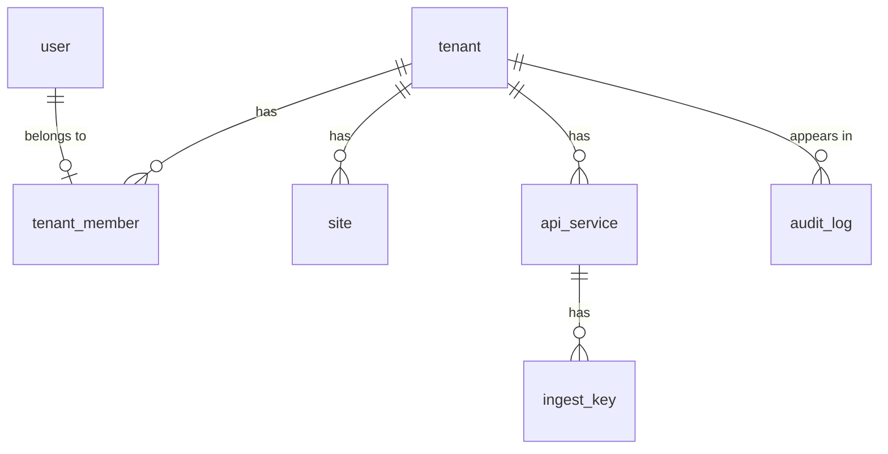

# E2 spec: tenants and access control

- **Status:** Accepted
- **Date:** 13 November 2026
- **Epic:** [#2 (E2)](https://github.com/romulospl/stellytics/issues/2)
- **Issues covered:** #16, #58, #59, #60, #17, #18, #19, #20 and #21
- **Depends on:** [ADR 0003](../decisions.md#0003-portal-isolation)
- **Implementation:** [what was done in E2](../e2-implementation.md)

This document fixes the contract that the E2 issues must respect: the data model of the `stellytics` database, the roles, the isolation rule, the ingest key and what each tenant status blocks. A decision with discarded alternatives goes in `docs/decisions.md`; only the chosen contract goes here.

The six decisions marked **D1** to **D6** were confirmed on 13 November 2026. They are gathered in [section 9](#9-decisions-made), with the discarded alternative of each one.

## 1. Starting point

What #57 already left in the code:

- Better Auth tables (`user`, `session`, `account`, `verification`) in the `stellytics` database;
- column `user.role` with the values `tenant` and `operator`, which the client cannot set;
- `requireSession()` and `requireOperator()` in `apps/portal/src/lib/session.ts`, always on the server;
- sign-up turned off (`disableSignUp: true`); accounts created by the script `scripts/create-user.mjs`;
- the IP of whoever signs in to the portal is not stored.

## 2. Roles

| Role | Where it lives | What it is |
|---|---|---|
| Tenant member | `user.role = 'tenant'` plus a row in `tenant_member` | A person from a project. Sees and manages only their own project |
| SCF operator | `user.role = 'operator'` | A person appointed by the SCF. Reads all projects and can remove or reactivate a project |
| Administrator | Not a role in the database | Whoever has access to the server. Creates and removes operators by command |

Rules:

- **D1.** Each user belongs to **a single tenant**. The `tenant_member` table already has the many-to-many shape, with a unique index on `user_id` that can be dropped in the future without changing the rest.
- **D2.** An operator **is not a tenant member**. Whoever is from the SCF and also has a project uses two accounts. This keeps the global role simple and separates the two functions.
- **D3.** There is no administrator role in the portal. An operator is only created by the admin script, and the promotion is recorded in `audit_log`.
- Inside the tenant there are two levels: `owner` (whoever created the project) and `member`. In the MVP both can do the same; the difference only starts to matter when there are member invites (outside this spec, see [section 10](#10-out-of-scope)).

### Permission matrix

| Action | Member | Operator | No session |
|---|---|---|---|
| See the web and API dashboards of their own tenant | Yes | — | No |
| Register a site and an API service in their own tenant | Yes | No | No |
| Create, list and revoke ingest keys of their own tenant | Yes | No | No |
| See another tenant's data | No (404) | Yes, read-only | No |
| See global and comparative dashboards | No (404) | Yes | No |
| Remove or reactivate a tenant | No | Yes | No |
| See ingest keys of any tenant | No | No (only prefix and dates) | No |
| Create an operator | No | No | No |

Another tenant's resource answers **404**, not 403, so as not to reveal that the resource exists. It is the same criterion that `requireOperator()` already uses.

## 3. Data model

Everything in the `stellytics` database, with Drizzle migrations. New identifiers are `uuid` generated by the database; `user.id` stays `text`, as Better Auth creates it.

### `tenant`

| Column | Type | Note |
|---|---|---|
| `id` | `uuid` PK | It is the `tenant.id` of the API metrics |
| `name` | `text` | Project name |
| `slug` | `text` unique | Generated from the name; used on the operator screens |
| `status` | enum `tenant_status` | `active`, `removed`, `pending`. Default `active` |
| `status_changed_at` | `timestamptz` | |
| `status_changed_by` | `text` FK `user.id` | Operator who changed the status |
| `status_reason` | `text` | Reason given by the operator |
| `created_at`, `updated_at` | `timestamptz` | |

### `tenant_member`

| Column | Type | Note |
|---|---|---|
| `tenant_id` | `uuid` FK | Composite PK with `user_id` |
| `user_id` | `text` FK `user.id` | Unique index (D1) |
| `role` | enum `member_role` | `owner`, `member` |
| `created_at` | `timestamptz` | |

### `site`

| Column | Type | Note |
|---|---|---|
| `id` | `uuid` PK | |
| `tenant_id` | `uuid` FK | |
| `name` | `text` | |
| `domain` | `text` | Unique per tenant |
| `umami_website_id` | `uuid` unique | Site ID in Umami. It is what the tracking script sends |
| `created_at`, `archived_at` | `timestamptz` | An archived site stops receiving events and disappears from the dashboards |

### `api_service`

| Column | Type | Note |
|---|---|---|
| `id` | `uuid` PK | |
| `tenant_id` | `uuid` FK | |
| `name` | `text` | Unique per tenant. It is the service name shown on the dashboards |
| `created_at`, `archived_at` | `timestamptz` | |

### `ingest_key`

| Column | Type | Note |
|---|---|---|
| `id` | `uuid` PK | |
| `api_service_id` | `uuid` FK | |
| `tenant_id` | `uuid` FK | Repeated here so the collector resolves the tenant without a join |
| `prefix` | `text` unique | Public part of the key, shown on the screens |
| `key_hash` | `bytea` | SHA-256 of the full key |
| `created_by` | `text` FK `user.id` | |
| `created_at`, `revoked_at` | `timestamptz` | |
| `last_used_on` | `date` | Day (UTC) of the last authentication at the collector; written at most once per day (see D4 and section 5) |

### `audit_log`

| Column | Type | Note |
|---|---|---|
| `id` | `uuid` PK | |
| `at` | `timestamptz` | |
| `actor_user_id` | `text` | Null when the action comes from the admin script |
| `action` | `text` | E.g. `tenant.removed`, `tenant.reactivated`, `operator.created`, `ingest_key.created`, `ingest_key.revoked` |
| `tenant_id` | `uuid` | Null in global actions |
| `details` | `jsonb` | Never contains a key, password or IP |

It only receives inserts. It meets the criterion of #20 ("removal recorded: who, when").

## 4. Isolation rule

The principle, decided in ADR 0003: **the tenant always comes from the session, never from a value sent by the client**.

### Access context

Two types, created only by server functions in `apps/portal/src/lib/access.ts`:

| Function | Returns | Failure |
|---|---|---|
| `requireTenantContext()` | `TenantContext { userId, tenantId, memberRole, tenantStatus }` | No session: goes to the login. Operator or user without a tenant: 404 |
| `requireOperatorContext()` | `OperatorContext { userId }` | Whoever is not an operator: 404 |

Both types are *branded*, so that no other code can build a context by hand.

### Single data layer

- All database access lives in `apps/portal/src/lib/data/`. Every exported function receives a context as its first argument and filters by `ctx.tenantId`.
- All Umami access lives in `apps/portal/src/lib/umami/`. The read functions receive a `TenantContext` and the portal's `site.id`; the function resolves the `umami_website_id` checking that the site belongs to the context's tenant. No public function accepts the Umami ID directly.
- An ESLint rule (`no-restricted-imports`) forbids importing the database client and the Umami HTTP client outside these two folders. That way, forgetting the filter becomes a lint error, not a production bug.
- The operator functions live in separate files (`lib/data/operator/`), receive `OperatorContext` and are read-only, with the exception of removing and reactivating a tenant.

### Routes

- Tenant routes **do not have the tenant ID in the URL** (`/dashboard`, `/sites/[siteId]`, `/services/[serviceId]`).
- Resource IDs in the URL (`siteId`, `serviceId`, `keyId`) are always checked against the context. Another tenant's resource answers 404.
- Operator routes live under `/operator` and are the only ones that accept a `tenantId` in the URL.

### Roles in Postgres

**D4.** Each service uses its own user of the `stellytics` database, with the minimum permission:

| User | Who uses it | Permission |
|---|---|---|
| `stellytics` | Portal | Owner of the tables |
| `stellytics_ingest` | Web gateway (#61) | `SELECT` on the `ingest_site` view (site ID in Umami and whether it accepts ingestion) |
| `stellytics_collector` | Collector (#30) | `SELECT` on the `ingest_key_active` view; `INSERT` on the metric tables; `EXECUTE` on `ingest_key_touch(text)` |

That way, a failure in the gateway or in the collector does not give access to emails, sessions or password hashes.

**Last use of the key.** The collector records `ingest_key.last_used_on` by calling `ingest_key_touch(prefix)` (migration `0008_ingest_key_last_used.sql`), a `SECURITY DEFINER` function that only updates that column, only for a key present in `ingest_key_active` and only if the date (UTC) changed. It is not a `GRANT UPDATE (last_used_on)` because the `UPDATE ... WHERE prefix = ...` would also require `SELECT` on `prefix`, `revoked_at` and other columns of the table, which would open the reading of revoked keys and of `key_hash`. With the function, `stellytics_collector` still has no privilege on `ingest_key`; `stellytics_ingest` does not have `EXECUTE`.

## 5. Ingest key

Contract between the portal (#59) and the collector (#30).

- **Format:** `ntf_<prefix>_<secret>`.
  - `prefix`: 8 random characters in lowercase base32. It is public and identifies the key on the screens and in the logs.
  - `secret`: 32 random bytes from the system's cryptographic generator, in base64url (43 characters).
- **Storage:** the database stores the `prefix` and the SHA-256 of the full key. Since the secret has 256 bits of entropy, a fast hash is enough and lets the collector validate at no cost.
- **Display:** the full key appears only once, in the creation response. After that only the prefix.
- **Sending:** in the `Authorization: Bearer <key>` header of OTLP, over HTTP and over gRPC.
- **Validation at the collector:** looks up by the prefix, compares the hash in constant time and checks that the key has not been revoked, that the service is not archived and that the tenant is `active`.
- **Cache:** the collector keeps the result for at most 60 seconds. With that, a revocation or the removal of the tenant takes effect within 1 minute (criterion of #59).
- **Limit:** up to 5 active keys per service, which allows changing keys without stopping ingestion.
- **What the key defines:** the tenant **and** the service. The `tenant.id` of the metrics always comes from the key. **D5.** The service also comes from the key: the `service.name` sent by the client is ignored, so that a client cannot inflate the number of services. The detail is left for the E5 spec.
- **Last use:** after authenticating, the collector writes `last_used_on` in the background, at most once per key and per UTC day in each process (function from D4). The write never delays or refuses a request; a failure only produces a warning in the log, with the error type.
- **Logs:** the full key is never logged. Only the prefix appears in a log.

## 6. Tenant status

| Status | Sign in to the portal | Tenant dashboards | Register site, service and key | Web and API ingestion | SCF global dashboards |
|---|---|---|---|---|---|
| `active` | Yes | Yes | Yes | Accepted | Appears |
| `removed` | Yes | Only a removed-project notice, with the reason | No | Refused | Does not appear in the comparisons; the operator can still open it |
| `pending` (only with `SIGNUP_APPROVAL`, #49) | Yes | Only a waiting screen (other pages and actions redirect to it) | No | Refused | Does not appear in the comparisons; the operator approves or rejects at `/operator/approvals` |

- **Removal is deactivation.** The data already collected stays in the database. Erasing the data of a removed tenant is a separate action, outside this spec.
- **D6.** The operator can **reactivate** a removed tenant. The action goes to the `audit_log`.
- **How ingestion finds out:** the gateway and the collector query the views from section 4 and keep the result for at most 60 seconds.
- **Response when refusing:** the gateway responds as if it had accepted (so as not to give a hint to someone testing IDs) and drops the event. The collector responds `401` (OTLP HTTP) or `Unauthenticated` (gRPC), because the service owner needs to know that the key is no longer valid.

## 7. Sign-up and provisioning

### Self-service sign-up (#17 and #60)

1. The person enters name, email and password (minimum of 12 characters, already configured).
2. The portal sends a confirmation link. Without confirming the email, they cannot create a project.
3. With the email confirmed, they enter the project name. The portal creates the `tenant` with status `active` and the row in `tenant_member` with `owner`, in the same transaction.
4. They register sites and API services. On creating a service, they receive the first ingest key.

When sign-up with approval is turned on (`SIGNUP_APPROVAL`, #49, [ADR 0007](../decisions.md#0007-sign-up-with-approval)), step 3 creates the tenant as `pending`. The operator approves (`active`) or rejects (`removed`, with a reason) at `/operator/approvals`, and each decision goes to the `audit_log` (`tenant.approved`, `tenant.rejected`).

### Site in Umami (#58)

- Each `site` of the portal corresponds to **one site in Umami**, created by the service account.
- The portal **does not create users or teams in Umami**. Nobody signs in to Umami: it stays on the internal network only (#62) and the isolation is the portal's (ADR 0003).
- Order when creating: first the site in Umami, then the row in `site`. If the write fails, the portal deletes the newly created site in Umami.
- A consistency test checks that every `umami_website_id` exists in Umami and that there is no site in Umami without a row in `site`.
- The service account is an ordinary Umami user (role `user`), authenticated by an API key in `UMAMI_API_KEY`. Confirmed in #58 and recorded in ADR 0001.

## 8. Isolation tests (#21)

The suite creates two tenants (A and B), each with a site, a service and a key, and an operator. Minimum cases:

| Case | Expected result |
|---|---|
| Member of A opens a site, service or key of B through the URL | 404 |
| Member of A calls a portal API route with an ID of B | 404 |
| Member of A opens `/operator` | 404 |
| Member of A tries to change their own role through the client | Ignored |
| Operator reads data of A and of B | Allowed |
| Operator tries to create a site or key in A | Refused |
| Key of A sends metrics claiming to be from tenant B | Stored as A |
| Revoked key of A | Refused within 60 seconds |
| Tenant B removed: web event and API metric of B | Dropped |
| User without a tenant opens `/dashboard` | Goes to project creation |
| Read from Umami with B's `umami_website_id` from A's context | Refused before reaching Umami |

Each new dashboard (#28 and #37) adds its own cases to this suite.

## 9. Decisions made

| No. | Decision | Discarded alternative | Effect if it changes |
|---|---|---|---|
| D1 | A user belongs to a single tenant | Several tenants per user, with switching of the active project | The session starts storing the active tenant and every screen gains the selector |
| D2 | An operator is not a tenant member | Global role separate from the role in the tenant | `requireTenantContext()` needs to accept an operator with a project |
| D3 | No administrator role; operator created by script | Administration screen in the portal | One more area to protect and test |
| D4 | One database user per service, with read-only views | Everyone uses the `stellytics` user | Simpler, but a failure in ingestion exposes the accounts |
| D5 | The service comes from the key; the client's `service.name` is ignored | Accept the client's `service.name` | Requires a cardinality limit per tenant at the collector |
| D6 | The operator can reactivate a removed tenant | Permanent removal | A project removed by mistake has to sign up again |

## 10. Out of scope

- **Member invites.** The model accepts several users per tenant, but there is no issue for the invite flow. Today only whoever creates the project has access. If it is needed for the pilots, create the issue.
- **Deletion of one's own account and of the project by the tenant.** The member's email is personal data, so the privacy document (#40) must provide for how the person requests erasure.
- **Erasing the data of a removed tenant.**
- **SCF API keys for reading the metrics** (#48, decided in [ADR 0006](../decisions.md#0006-scf-read-api)) and **sign-up with approval** (#49), which are post-MVP. The model already provides for the `pending` status.
- **Schema of the API metrics**, which is in the E5 spec.

## 11. Effect on the issues

| Issue | What the spec defines for it |
|---|---|
| #16 | Tables `tenant`, `tenant_member`, `site`, `api_service`, `ingest_key` and `audit_log` (section 3) |
| #58 | One site in Umami per `site`, without users or teams (section 7) |
| #59 | Format, hash, limit and revocation of the key (section 5) |
| #60 and #17 | Sign-up flow (section 7) |
| #18 | Access context, single layer and lint rule (section 4) |
| #19 | Roles and permission matrix (section 2) |
| #20 | Status and refusal of ingestion (section 6) |
| #21 | Minimum cases (section 8) |
| #12, #61 and #30 | Because of D4, the database creation script gains the users `stellytics_ingest` and `stellytics_collector`. The change to the script comes in #16, together with the views |
