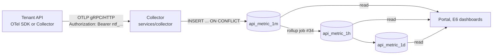

# E5 spec: API analytics pipeline

- **Status:** Accepted
- **Date:** 14 November 2026
- **Epic:** [#5 (E5)](https://github.com/romulospl/stellytics/issues/5)
- **Issues covered:** #30, #31, #32, #33, #34, #35 and #36
- **Depends on:** [ADR 0002](../decisions.md#0002-architecture-and-stack) and the [E2 spec](e2-tenants-and-access-control.md) (section 5, ingest key; section 6, tenant status)

This document fixes the contract between the collector (`services/collector`), the `stellytics` database and the API dashboards (E6). It covers what goes into the collector, what comes out of it, the route normalization rules, the metric tables and retention. The decisions marked **D1** to **D9** were confirmed on 14 November 2026 and are gathered in [section 8](#8-decisions-made).

## 1. Flow

1. The tenant sends the same OTLP it already sends to its own APM (dual-export, #35).
2. The collector validates the key (E2 spec, section 5). The key defines the **tenant and the service**; no client attribute changes that. The `tenantattr` processor writes both into the resource attributes `stellytics.tenant.id` and `stellytics.api_service.id`, which are the only ones the following components read.
3. The collector turns HTTP server spans and the `http.server.request.duration` metric into a count and a histogram (#31), normalizes the route (#32) and drops everything else.
4. On each batch, it writes 1-minute time buckets to `api_metric_1m` (#33).
5. A job rolls 1 minute up into 1 hour and 1 day and applies retention (#34).

## 2. What the collector accepts

| Input | What it becomes | Note |
|---|---|---|
| Span with `span.kind = SERVER` and `http.request.method` (or `http.method`) | One request | The duration is `end - start`. The time bucket is the minute of the span's end (D6) |
| Metric `http.server.request.duration` (histogram in seconds) or the old `http.server.duration` (in milliseconds, by the unit `ms`) | The requests already counted | The buckets are added to ours, as long as the bounds match those of section 4. If they do not match, each source bucket falls into our bucket that contains its upper bound. The time bucket is the minute of the point's `Timestamp` |
| Any other span, metric or log | Nothing | Dropped at the collector. Never stored |

Attributes read from the span or from the metric point: `http.route`, `url.path` (or `http.target`, in the old conventions), `http.request.method` (or `http.method`) and `http.response.status_code` (or `http.status_code`). The others, including `service.name` (D5 of E2), user IDs, `url.query`, IP and User-Agent, are ignored.

**The metric takes priority over the span (D9).** If a service sent the metric in the last 15 minutes, its server spans are ignored, so that the same request does not count twice in a dual-export with traces and metrics. When switching from one source to the other, there may be double counting for up to one batch.

**Temporality.** `delta` points go in as received. `cumulative` points (the default of several SDKs) become delta at the collector, which keeps in memory the last value of each series (metric, resource attributes and point attributes). The first time it sees a series, the collector only counts the whole value if the process started at most 5 minutes ago (`Timestamp - StartTimestamp`); otherwise, it keeps it as a baseline and counts from the next point, so as not to add again everything the process counted before a collector restart. A drop in the value or a new `StartTimestamp` indicates a process restart: the point counts in full. The dual-export guide (#35) recommends delta.

Without a route (neither `http.route` nor path), it stores `{unknown}`. Methods outside the standard HTTP list (`GET`, `HEAD`, `POST`, `PUT`, `DELETE`, `CONNECT`, `OPTIONS`, `TRACE`, `PATCH`) become `_OTHER`, as the OpenTelemetry conventions ask. Without a status, it stores `0`.

## 3. Route normalization (#32)

The goal is that `/accounts/GABC.../payments/` and `/accounts/GXYZ.../payments` count as the same route, `/accounts/{address}/payments`, without blowing up cardinality.

1. **If the client sent `http.route`, it is used** (it is the framework's template, such as `/users/:id`). It only goes through the size rule of step 4.
2. Otherwise, it starts from `url.path` (or `http.target`) without query string or fragment. A full URL becomes only the path.
3. Each segment between slashes is replaced by the first placeholder that matches, in this order:

| Placeholder | Segment that matches | Example |
|---|---|---|
| `{uuid}` | UUID 8-4-4-4-12 in hexadecimal, case-insensitive | `3f2c...-...` |
| `{address}` | Stellar address in StrKey: `G` or `C` with 56 characters or `M` with 69, all in uppercase base32 (`A-Z2-7`) | `GABC...`, `CDEF...`, `MAAA...` |
| `{hash}` | Hexadecimal with 16 characters or more, with or without `0x` (transaction, ledger or block hash) | `a1b2c3...` |
| `{id}` | Digits only | `42`, `1700000000` |

4. The trailing slash is removed (except at the root `/`), repeated slashes become a single one, and the empty path becomes `/`. A route longer than 256 bytes is cut at the end of the last whole segment that fits in the 256 (a single segment larger than that is cut at 256, without splitting a UTF-8 character).
5. The placeholders are fixed in the code, as the RFP asks. There is no rule configurable per tenant in the MVP.

The `{address}` rule checks only the format (prefix, size and alphabet), not the StrKey checksum: a segment of 56 uppercase letters of that alphabet starting with `G` is, in practice, always an address.

**Cardinality cap (D4):** each service stores at most 500 distinct routes per day. From the 501st on, the day's new routes are stored as `{other}`. The cap lives in the collector (#31) and protects the database from a client that sends unique paths (free-text search in the path, for example).

## 4. Metric tables (#33)

Everything in the `stellytics` database, in a migration written by hand in the portal (`apps/portal/drizzle/`, like `0002_ingest_views.sql`). The portal is the only owner of the database migrations (D5).

### `api_metric_1m`, `api_metric_1h` and `api_metric_1d`

The three have the same columns and differ only in the size of the time bucket.

| Column | Type | Note |
|---|---|---|
| `bucket_start` | `timestamptz` | Start of the time bucket (minute, hour or day, in UTC) |
| `tenant_id` | `uuid` | From the ingest key |
| `api_service_id` | `uuid` | From the ingest key |
| `route` | `text` | Normalized route (section 3) |
| `method` | `text` | HTTP method or `_OTHER` (D1) |
| `status_code` | `smallint` | `0` when it did not come |
| `request_count` | `bigint` | Number of requests |
| `duration_sum` | `double precision` | Sum of the durations, in seconds |
| `duration_buckets` | `bigint[]` | Count per duration bucket (D2) |

- **Primary key:** `(tenant_id, api_service_id, route, method, status_code, bucket_start)`. The collector writes with `INSERT ... ON CONFLICT DO UPDATE`, adding count, sum and buckets.
- **Partitioning (D5):** by range of `bucket_start`, one partition per month, plus a `default` partition so as never to refuse a point. The function `api_metric_ensure_partitions(months)` creates the partitions of the current month and of the following ones; the job from #34 calls it every day. The migration already creates those of the current month and of the two following ones.
- **Index for the dashboards:** `(tenant_id, bucket_start)`, which serves "period X of the tenant" filtering by service and route. The primary key already serves the lookup by series.
- **Foreign keys:** none. In a partitioned, high-volume table, integrity comes from the ingest key, which only exists for a valid service.

### Duration buckets (D2)

Upper bounds in seconds, equal to the recommendation of the OpenTelemetry conventions for `http.server.request.duration`, so that ready-made histograms go in without conversion:

`0.005, 0.01, 0.025, 0.05, 0.075, 0.1, 0.25, 0.5, 0.75, 1, 2.5, 5, 7.5, 10` and a last bucket above 10 s. There are 15 positions in `duration_buckets`; position `i` counts the durations in `(bound[i-1], bound[i]]`.

### Percentiles

The aggregate `api_metric_sum_buckets(duration_buckets)` sums the arrays by position (the function `api_metric_add_buckets(a, b)` does the same for two arrays, in the collector's `ON CONFLICT`), and `api_metric_bounds()` returns the bounds. The function `api_metric_quantile(buckets bigint[], q double precision)` returns the percentile `q` (0 to 1), interpolating linearly inside the bucket where it falls. When it falls in the last bucket (above 10 s), it returns 10. For a period, the dashboards sum the arrays by position and apply the function over the sum. The error is at most the width of the bucket, which is enough for API p50 and p95.

### Permissions

| User | Permission |
|---|---|
| `stellytics_collector` | `SELECT` on `ingest_key_active` (E2); `SELECT`, `INSERT` and `UPDATE` on `api_metric_1m`, because `INSERT ... ON CONFLICT DO UPDATE` needs to read the existing row. Nothing on the rolled-up tables or on partition maintenance |
| `stellytics` (portal and job from #34) | Owner of the tables |
| `stellytics_ingest` | None |

## 5. Aggregation and retention (#34)

- The job reads `api_metric_1m` and writes `api_metric_1h` and `api_metric_1d` with an `INSERT ... ON CONFLICT DO UPDATE` that **replaces** the values with the recalculated sum. Running the job twice over the same period gives the same result.
- It only rolls up closed time buckets: hours that ended at least 5 minutes ago, because of late batches.
- **Retention (D3):** `api_metric_1m` for 35 days; `api_metric_1h` and `api_metric_1d` for 25 months (at least 24 months, as the RFP asks). Retention deletes whole partitions (`DROP TABLE` of the partition), never row by row.
- **Where it runs:** SQL functions from migration `0005_api_metric_rollup.sql` (`api_metric_rollup(since, until)`, `api_metric_drop_partitions(at)` and `api_metric_maintain(lookback)`, only for the owner `stellytics`), called by the Go service `services/rollup` every 15 minutes (`ROLLUP_INTERVAL`), re-rolling the last 48 hours (`ROLLUP_LOOKBACK`). Each run creates the future partitions, rolls up and applies retention.
- `api_metric_1h` comes from `api_metric_1m`; `api_metric_1d` comes from `api_metric_1h`, only from the hours already closed. The current day stays partial and is redone on each run.
- The monthly partition goes away when the **end** of the month becomes older than the period: the granular data stays between 35 and 66 days, the rolled-up data between 25 and 26 months. The `default` partition is never deleted.

### Volume estimate for 1 million requests per day

The number of rows depends on the active series (route × method × status per service), not on the requests: each series produces at most one row per time bucket. 1 million requests per day are about 700 per minute. Calculation with about 400 bytes per row, adding data (15 `bigint` positions in the buckets), primary key and the `(tenant_id, bucket_start)` index.

| Scenario | `api_metric_1m` (up to 66 days) | `api_metric_1h` (up to 26 months) | `api_metric_1d` (up to 26 months) |
|---|---|---|---|
| Typical: 100 series active in every minute | 144 thousand rows/day, ~58 MB/day, up to ~3.8 GB | 2,400 rows/day, ~1 MB/day, up to ~0.8 GB | 100 rows/day, up to ~32 MB |
| Worst case: each request in a distinct series (~700/min, limited by the cap of 500 routes/day of D4) | ~1 million rows/day, ~400 MB/day, up to ~26 GB | up to ~48 thousand rows/day (2,000 series), ~19 MB/day, up to ~15 GB | ~2,000 rows/day, up to ~0.6 GB |

The typical case fits comfortably on the disk of the production VM; the worst case calls for watching the size of `api_metric_1m` and, if needed, shortening the retention of the granular data.

## 6. Isolation

- The `tenant_id` and the `api_service_id` of every row come from the validated key. An attribute sent by the client never changes that.
- The dashboards (E6) read the tables through the portal's `src/lib/data/` layer, always filtering by the context's tenant (ADR 0003). The API metric cases go into the isolation suite (#21).

## 7. Tests

| Issue | What must be covered |
|---|---|
| #32 | Each placeholder with positive and negative cases, the priority of `http.route`, trailing slash, query string and the example `/accounts/G.../payments/` |
| #33 | Upsert adding, known p50 and p95 over buckets built by hand, the `default` partition receiving a point outside the monthly ones and the permissions of `stellytics_collector` |
| #34 | Idempotent job, retention deleting an old partition |
| #31 and #36 | Real OTLP payload: no span or log stored, high-cardinality attribute left out, tenant and service coming from the key |

## 8. Decisions made

| No. | Decision | Discarded alternative | Why |
|---|---|---|---|
| D1 | The HTTP method is a dimension | Only route and status, as #33 lists | `GET` and `POST` on the same route have very different latency and volume; there are only 10 possible values |
| D2 | Fixed buckets from the OTel conventions, in seconds | Own buckets in milliseconds | Ready-made histograms (`http.server.request.duration`) go in without conversion |
| D3 | 1 minute for 35 days; 1 hour and 1 day for 25 months | Keep the granular data for 24 months | The granular data is the largest volume, and the long-period dashboards use hour or day |
| D4 | Cap of 500 distinct routes per service per day, with the excess in `{other}` | No cap | Without it, a client that sends unique paths creates one row per request |
| D5 | Tables partitioned by month, in a portal migration, with a `default` partition | The collector's own migrations | A single owner of the `stellytics` database migrations; the `default` partition avoids losing a point if the job is late |
| D6 | The time bucket is the minute of the span's end | Minute of the start | It is when the request finished, as in the OTel metrics |
| D7 | One `{address}` placeholder for G, C and M | Separate placeholders for account, contract and muxed | The surrounding path already says what it is (`/accounts/`, `/contracts/`); fewer placeholders, simpler dashboard |
| D8 | `{hash}` requires 16 hexadecimal characters or more | Any hexadecimal segment | Avoids replacing words such as `cafe` or `add` with `{hash}` |
| D9 | The `http.server.request.duration` metric takes priority: with it in the last 15 minutes, the service's spans are ignored (14 November 2026) | Spans with priority; spans only | The metric already comes aggregated and does not suffer from trace sampling; spans are left for whoever only sends traces |

## 9. Out of scope

- Normalization rules configurable per tenant.
- Client metrics (`span.kind = CLIENT`), database metrics or queue metrics.
- Alerts and SLOs per route.
- SCF API keys for reading the metrics (#48), which are post-MVP.
